# Dental Flow

Especificação de Design de Software (SDD) do frontend integrado. Revisão de 29/10/2026; commit de referência: `87fbfcd0148346079a5476bd37de54cbea5c4f5d`.

## 1. Visão Geral

O Dental Flow é uma aplicação web acadêmica para organizar as atividades de uma clínica odontológica. O frontend atual reúne acompanhamento do dia, agenda, pacientes, dados da clínica, dentistas, procedimentos, painel mensal, mapa clínico diário e estoque de materiais/equipamentos. A proposta é reduzir a dispersão dos registros operacionais e apoiar o acompanhamento do atendimento e dos valores lançados. O público é a equipe de recepção e os dentistas. A plataforma principal é web responsiva, com referência automatizada em desktop de 1440 px e celular de 375 px, sem modelo físico definido. A stack usa React, Vite, JavaScript/JSX, CSS Modules e MVVM, consumindo a API Java/Spring Boot. A entrega é esta especificação Markdown e a planilha SDD; Figma e Google Stitch são destinos opcionais. Orçamentos, odontograma, caixa independente, auditoria e recuperação automática não têm telas no escopo atual.

## 2. Personas e Implicações de Design

### P-DF02 — Recepção

Perfil funcional do accessLevel RECEPCIONISTA, sem pesquisa de persona.
Opera Hoje, Agenda e Pacientes e consulta dados de Clínica, Dentistas e Procedimentos.
Idade, familiaridade, dispositivo pessoal e dores não foram pesquisados.

Implicações de design:

- Acesso restrito ao perfil → exibir menu permitido e tratar tentativa de rota protegida com a tela de sem acesso.
- Organização das consultas → destacar próximo paciente, pendências de confirmação e situação com ícone/texto/forma.
- Localizar cadastro → busca por nome sem acento, CPF ou telefone e volta à página anterior da lista.
- Campos obrigatórios da API → rótulos visíveis, marcação de opcionais e mensagens junto ao campo.

### P-DF04 — Dentista

Perfil funcional do accessLevel DENTISTA, sem pesquisa de persona.
Inclui operações da recepção, painel, mapas, estoque, manutenção dos cadastros e criação de acesso.
Idade, dores e condições de uso não informadas permanecem em aberto.

Implicações de design:

- Conferir o dia → totais nomeados e valores em reais; marcar linhas antes do fechamento.
- Ações irreversíveis → confirmação para fechar mapa, cancelar consulta e marcar falta.
- Reposição de materiais → aviso e rótulo Em falta/Abaixo do mínimo/Em dia, sem depender apenas da cor.
- Acompanhamento mensal → seletor de mês, filtro de dentista e leitura dos indicadores devolvidos pela API.

P-DF01 (Administrador) e P-DF03 (Financeiro) são perfis históricos sem accessLevel atual. Não criar permissões a partir deles.

## 3. Design Tokens

Os tokens de cor, raio e sombra são de `frontend/src/style/tokens.css`. A fonte atual é Figtree, substituindo a IBM Plex Sans da documentação anterior. Tipografia, espaçamentos e dimensões têm aliases documentais `(derivado)`, pois o CSS ainda usa valores literais. Esses aliases não foram adicionados à aplicação. Não inferir conformidade WCAG de uma cor isolada; os pares efetivamente avaliados estão na seção 8.

### Cores

| Token | HEX | RGB | Papel | Onde é usada | Cor do texto sobre ela | Contraste | WCAG AA |
| --- | --- | --- | --- | --- | --- | --- | --- |
| --background | #F6F2EC | 246, 242, 236 | Superfície | src/style/tokens.css; uso semântico --background | --foreground | 14.02 | Sim |
| --foreground | #1B2529 | 27, 37, 41 | Texto, borda, foco ou gráfico | src/style/tokens.css; uso semântico --foreground | Não é fundo de texto | 14.02 | Sim para o critério |
| --card | #FFFFFF | 255, 255, 255 | Superfície | src/style/tokens.css; uso semântico --card | --foreground | 15.63 | Sim |
| --card-soft | #FBF8F4 | 251, 248, 244 | Superfície | src/style/tokens.css; uso semântico --card-soft | --foreground | 14.77 | Sim |
| --muted | #EEE8DF | 238, 232, 223 | Superfície | src/style/tokens.css; uso semântico --muted | --muted-foreground | 4.79 | Sim |
| --muted-foreground | #5B676C | 91, 103, 108 | Texto, borda, foco ou gráfico | src/style/tokens.css; uso semântico --muted-foreground | Não é fundo de texto | 5.83 | Sim para o critério |
| --border | #EAE3D9 | 234, 227, 217 | Texto, borda, foco ou gráfico | src/style/tokens.css; uso semântico --border | Não é fundo de texto | 1.27 | Pendente |
| --input | #CFC6B9 | 207, 198, 185 | Texto, borda, foco ou gráfico | src/style/tokens.css; uso semântico --input | Não é fundo de texto | 1.69 | Pendente |
| --ring | #0D6E66 | 13, 110, 102 | Texto, borda, foco ou gráfico | src/style/tokens.css; uso semântico --ring | Não é fundo de texto | Ver pares na seção 8 | Não aplicável isoladamente |
| --primary | #0D6E66 | 13, 110, 102 | Superfície | src/style/tokens.css; uso semântico --primary | --primary-foreground | 6.11 | Sim |
| --primary-hover | #0A5C55 | 10, 92, 85 | Superfície | src/style/tokens.css; uso semântico --primary-hover | --primary-foreground | 7.85 | Sim |
| --primary-foreground | #FFFFFF | 255, 255, 255 | Texto, borda, foco ou gráfico | src/style/tokens.css; uso semântico --primary-foreground | Não é fundo de texto | 6.11 | Sim para o critério |
| --primary-soft | #E1F0EC | 225, 240, 236 | Superfície | src/style/tokens.css; uso semântico --primary-soft | --primary | 5.2 | Sim |
| --accent | #E8613C | 232, 97, 60 | Superfície | src/style/tokens.css; uso semântico --accent | --foreground | 4.62 | Sim |
| --accent-text | #B9472A | 185, 71, 42 | Texto, borda, foco ou gráfico | src/style/tokens.css; uso semântico --accent-text | Não é fundo de texto | 4.49 | Pendente |
| --accent-soft | #FDE9E2 | 253, 233, 226 | Superfície | src/style/tokens.css; uso semântico --accent-soft | --accent-text | 4.49 | Não para texto normal |
| --destructive | #B23B3B | 178, 59, 59 | Texto, borda, foco ou gráfico | src/style/tokens.css; uso semântico --destructive | Não é fundo de texto | 4.94 | Sim para o critério |
| --destructive-soft | #FBE7E7 | 251, 231, 231 | Superfície | src/style/tokens.css; uso semântico --destructive-soft | --destructive | 4.94 | Sim |
| --warning | #7A5000 | 122, 80, 0 | Texto, borda, foco ou gráfico | src/style/tokens.css; uso semântico --warning | Não é fundo de texto | 6.31 | Sim para o critério |
| --warning-soft | #FFF1D2 | 255, 241, 210 | Superfície | src/style/tokens.css; uso semântico --warning-soft | --warning | 6.31 | Sim |
| --success | #1D7A45 | 29, 122, 69 | Texto, borda, foco ou gráfico | src/style/tokens.css; uso semântico --success | Não é fundo de texto | 4.65 | Sim para o critério |
| --success-soft | #E2F3E8 | 226, 243, 232 | Superfície | src/style/tokens.css; uso semântico --success-soft | --success | 4.65 | Sim |
| --info | #2F5E9E | 47, 94, 158 | Texto, borda, foco ou gráfico | src/style/tokens.css; uso semântico --info | Não é fundo de texto | 5.54 | Sim para o critério |
| --info-soft | #E5EDF8 | 229, 237, 248 | Superfície | src/style/tokens.css; uso semântico --info-soft | --info | 5.54 | Sim |
| --whatsapp | #187A43 | 24, 122, 67 | Texto, borda, foco ou gráfico | src/style/tokens.css; uso semântico --whatsapp | Não é fundo de texto | 4.71 | Sim para o critério |
| --whatsapp-soft | #E3F4EA | 227, 244, 234 | Superfície | src/style/tokens.css; uso semântico --whatsapp-soft | --whatsapp | 4.71 | Sim |
| --chart-in | #2E9D67 | 46, 157, 103 | Texto, borda, foco ou gráfico | src/style/tokens.css; uso semântico --chart-in | Não é fundo de texto | 3.42 | Sim para o critério |
| --chart-out | #E0603C | 224, 96, 60 | Texto, borda, foco ou gráfico | src/style/tokens.css; uso semântico --chart-out | Não é fundo de texto | 3.55 | Sim para o critério |
| --status-agendado-fg | #7A5000 | 122, 80, 0 | Texto, borda, foco ou gráfico | src/style/tokens.css; uso semântico --status-agendado-fg | Não é fundo de texto | 7.06 | Sim para o critério |
| --status-agendado-bg | #FFFFFF | 255, 255, 255 | Superfície | src/style/tokens.css; uso semântico --status-agendado-bg | --status-agendado-fg | 7.06 | Sim |
| --status-agendado-bar | #D9940E | 217, 148, 14 | Texto, borda, foco ou gráfico | src/style/tokens.css; uso semântico --status-agendado-bar | Não é fundo de texto | Ver pares na seção 8 | Não aplicável isoladamente |
| --status-confirmado-fg | #17663B | 23, 102, 59 | Texto, borda, foco ou gráfico | src/style/tokens.css; uso semântico --status-confirmado-fg | Não é fundo de texto | 6 | Sim para o critério |
| --status-confirmado-bg | #DCF3E5 | 220, 243, 229 | Superfície | src/style/tokens.css; uso semântico --status-confirmado-bg | --status-confirmado-fg | 6 | Sim |
| --status-confirmado-bar | #1F8A4C | 31, 138, 76 | Texto, borda, foco ou gráfico | src/style/tokens.css; uso semântico --status-confirmado-bar | Não é fundo de texto | Ver pares na seção 8 | Não aplicável isoladamente |
| --status-atendimento-fg | #FFFFFF | 255, 255, 255 | Texto, borda, foco ou gráfico | src/style/tokens.css; uso semântico --status-atendimento-fg | Não é fundo de texto | 6.83 | Sim para o critério |
| --status-atendimento-bg | #5B45C2 | 91, 69, 194 | Superfície | src/style/tokens.css; uso semântico --status-atendimento-bg | --status-atendimento-fg | 6.83 | Sim |
| --status-atendimento-bar | #3E2C99 | 62, 44, 153 | Texto, borda, foco ou gráfico | src/style/tokens.css; uso semântico --status-atendimento-bar | Não é fundo de texto | Ver pares na seção 8 | Não aplicável isoladamente |
| --status-concluido-fg | #4A5559 | 74, 85, 89 | Texto, borda, foco ou gráfico | src/style/tokens.css; uso semântico --status-concluido-fg | Não é fundo de texto | 6.6 | Sim para o critério |
| --status-concluido-bg | #ECEEEF | 236, 238, 239 | Superfície | src/style/tokens.css; uso semântico --status-concluido-bg | --status-concluido-fg | 6.6 | Sim |
| --status-concluido-bar | #A3ACB0 | 163, 172, 176 | Texto, borda, foco ou gráfico | src/style/tokens.css; uso semântico --status-concluido-bar | Não é fundo de texto | Ver pares na seção 8 | Não aplicável isoladamente |
| --status-cancelado-fg | #A12F2F | 161, 47, 47 | Texto, borda, foco ou gráfico | src/style/tokens.css; uso semântico --status-cancelado-fg | Não é fundo de texto | 5.97 | Sim para o critério |
| --status-cancelado-bg | #FBE7E7 | 251, 231, 231 | Superfície | src/style/tokens.css; uso semântico --status-cancelado-bg | --status-cancelado-fg | 5.97 | Sim |
| --status-cancelado-bar | #D16464 | 209, 100, 100 | Texto, borda, foco ou gráfico | src/style/tokens.css; uso semântico --status-cancelado-bar | Não é fundo de texto | Ver pares na seção 8 | Não aplicável isoladamente |
| --status-faltou-fg | #934010 | 147, 64, 16 | Texto, borda, foco ou gráfico | src/style/tokens.css; uso semântico --status-faltou-fg | Não é fundo de texto | 6.06 | Sim para o critério |
| --status-faltou-bg | #FCEBDD | 252, 235, 221 | Superfície | src/style/tokens.css; uso semântico --status-faltou-bg | --status-faltou-fg | 6.06 | Sim |
| --status-faltou-bar | #E07B3F | 224, 123, 63 | Texto, borda, foco ou gráfico | src/style/tokens.css; uso semântico --status-faltou-bar | Não é fundo de texto | Ver pares na seção 8 | Não aplicável isoladamente |

### Tipografia

| Elemento (derivado) | Fonte | Peso | Tamanho px / rem | Altura de linha | Uso |
| --- | --- | --- | --- | --- | --- |
| texto-titulo | Figtree | 800 | 34 px / 2,125 rem | 1,1 | PageHeader desktop |
| texto-titulo-mobile | Figtree | 800 | 28 px / 1,75 rem | 1,1 | PageHeader <768 px |
| texto-card | Figtree | 800 | 18 px / 1,125 rem | herda 1,5 | Card h2 |
| texto-corpo | Figtree | 400 | 16 px / 1 rem | 1,5 | Base do navegador (suposição: raiz 16 px) |
| texto-label | Figtree | 700 | 15 px / 0,9375 rem | 1,5 | Field label |
| texto-controle | Figtree | 400 | 16,5 px / 1,03125 rem | herdada | Input/Select |
| texto-ajuda | Figtree | 400 | 14 px / 0,875 rem | 1,5 | Field hint |
| texto-erro | Figtree | 600 | 14,5 px / 0,90625 rem | 1,5 | Field error |

Conversão rem considera raiz de 16 px. O código não fixa todas as medidas via rem.

### Espaçamento e dimensões

| Token documental | Valor | Origem |
| --- | --- | --- |
| espaco-4 | 4 px | (derivado) |
| espaco-8 | 8 px | (derivado) |
| espaco-16 | 16 px | (derivado) |
| espaco-24 | 24 px | (derivado) |
| espaco-32 | 32 px | (derivado) |
| gap-field | 6 px | (derivado de field.module.css) |
| gap-form | 16 px | (derivado de form_page.module.css) |
| largura-form | 820 px | (derivado de display.module.css) |
| largura-wide | 1180 px | (derivado de display.module.css) |
| largura-shell | 1480 px | (derivado de app_shell.module.css) |
| altura-controle | 50 px | (derivado de field.module.css) |
| altura-botao-sm | 38 px | (derivado de button.module.css) |
| altura-botao-md | 46 px | (derivado de button.module.css) |
| altura-botao-lg | 54 px | (derivado de button.module.css) |
| alvo-icone | 44 px | (derivado de button.module.css) |

A escala de quatro/oito serve como referência documental; o CSS existente também usa intervalos intermediários. Não arredondar silenciosamente as medidas da implementação.

### Raio de borda e sombras

| Token | Valor | Uso |
| --- | --- | --- |
| --radius-sm | 10 px | Raio pequeno |
| --radius | 14 px | Raio base |
| --radius-lg | 20 px | Cards |
| --radius-xl | 24 px | Raio amplo |
| --radius-full | 999 px | Chips e situações |
| --shadow-sm | 0 1px 2px rgba(27,37,41,.06) | Sombra pequena |
| --shadow | 0 8px 24px rgba(27,37,41,.08) | Elevação |
| --shadow-lg | 0 24px 50px rgba(27,37,41,.18) | Painéis |
| raio-botao-md (derivado) | 12 px | Valor literal atual de .button |
| raio-controle (derivado) | 14 px | Valor literal atual de .control |

## 4. Tom de Voz

Tom observado: acolhedor, objetivo, orientador e transparente. Nomear a tarefa; usar verbo no CTA; indicar correção ao errar; confirmar somente após sucesso da chamada; explicar ausência de dados ou limitações reais. Os exemplos de Não faça são editoriais e não integram o conteúdo da interface.

| Atributo | Aplicação | Regra | Faça — literal existente | Não faça — exemplo editorial |
| --- | --- | --- | --- | --- |
| Acolhedor | Título | Nomear tarefa diretamente | Entrar | Bem-vindo à revolução da odontologia |
| Objetivo | CTA | Usar ação concreta existente | Salvar paciente | OK |
| Orientador | Erro | Indicar o campo e a correção | O CPF tem 11 números. | Erro 422 |
| Claro | Sucesso | Confirmar operação concluída | Mapa do dia salvo | Processado |
| Útil | Vazio | Indicar ausência e próximo passo | Nenhum paciente cadastrado | Sem conteúdo |
| Transparente | Ajuda | Explicar limitações reais | Sem duração, a agenda considera 30 minutos. | Horários garantidos sem conflito |

## 5. Biblioteca de Componentes

Estados que não se aplicam a um componente de leitura não representam funcionalidade faltante. Medidas derivadas só documentam o CSS atual. As propriedades reais de cada componente estão em `src/component/ui`.

### C01 — Page, PageHeader, FormPage, AppShell

- **Anatomia:** Marca, navegação, título, subtítulo, voltar, ações e região de conteúdo.
- **Variantes e tamanhos:** Page form/wide; shell desktop/mobile.
- **Tokens por parte:** largura-form; largura-wide; largura-shell; --page-x; --background; --card; texto-titulo; gap-form.
- **Estados e interação:** Foco no conteúdo; ativo na rota; skeleton/erro na página; rodapé sticky usa --tabbar.

### C02 — Button, ButtonLink, ExternalButton, IconButton

- **Anatomia:** Ícone opcional, rótulo, spinner e área de ação.
- **Variantes e tamanhos:** primary, secondary, ghost, soft, danger, whatsapp, dark; sm/md/lg; IconButton.
- **Tokens por parte:** --primary; --primary-hover; --primary-foreground; --destructive; --whatsapp; --foreground; --card; altura-botao-sm/md/lg; alvo-icone; raio-botao-md.
- **Estados e interação:** Padrão; hover; focus-visible; active; disabled; busy troca ícone e desabilita; erro é Alert externo.

### C03 — Field, Input, Textarea, Checkbox

- **Anatomia:** Rótulo, opcional, controle, ícone, ajuda e erro associado.
- **Variantes e tamanhos:** Input texto/senha/data/hora/número; textarea; checkbox.
- **Tokens por parte:** --foreground; --card; --input; --primary; --primary-soft; --destructive; --destructive-soft; altura-controle; raio-controle; texto-label; texto-controle; texto-ajuda; texto-erro.
- **Estados e interação:** Padrão; foco; aria-invalid; disabled; loading de CEP via Spinner; hover/ativo sem regra própria de validação.

### C04 — Combobox

- **Anatomia:** Campo de pesquisa, lista de opções, indicação selecionada e mensagem vazia.
- **Variantes e tamanhos:** Dentista e procedimento; texto + detalhe.
- **Tokens por parte:** --card; --foreground; --input; --primary; --muted; --radius.
- **Estados e interação:** Aberto/fechado; digitando; foco por setas; Enter escolhe; Escape fecha; seleção por ID.

### C05 — FormGrid, Select, AddressFields

- **Anatomia:** Grid de campos, select fixo, CEP/endereço e feedback de consulta.
- **Variantes e tamanhos:** Uma coluna mobile; duas ou três conforme formulário; endereço de clínica inclui Cidade/UF.
- **Tokens por parte:** gap-form; --input; --card; --foreground; --primary; --muted-foreground; altura-controle.
- **Estados e interação:** Padrão; erro de campo; CEP consultando, encontrado/inexistente/falha; fallback manual.

### C06 — Card, Stat, Avatar, DefinitionList

- **Anatomia:** Título, corpo, ação opcional; indicador com nome/valor/ajuda; iniciais de pessoa.
- **Variantes e tamanhos:** Card simples; Stat tons semânticos; Avatar xs/sm/md/lg/xl.
- **Tokens por parte:** --card; --card-soft; --foreground; --muted-foreground; --radius-lg; --border; texto-card.
- **Estados e interação:** Leitura; carregando substituído por Skeleton; erro por ErrorState; vazio por EmptyState; foco só em ações.

### C07 — Chips, Segmented, StatusPill, Badge, StepTrack

- **Anatomia:** Opções, estado selecionado e rótulo; status com ícone, texto e forma.
- **Variantes e tamanhos:** Filtros; visão de agenda; tipo; seis situações da consulta.
- **Tokens por parte:** --primary; --primary-soft; --muted; --radius-full; --status-*-fg/bg/bar.
- **Estados e interação:** Hover, foco, aria-pressed/selecionado; status não editável por si; 38/40 px atuais abaixo da meta 44.

### C08 — ListHeader, Paginated

- **Anatomia:** Cabeçalho visual, lista, contador, navegação e página na URL.
- **Variantes e tamanhos:** Pacientes, catálogos, estoque e movimentos; ListHeader oculto no mobile.
- **Tokens por parte:** --foreground; --muted-foreground; --border; --card; espaco-16.
- **Estados e interação:** Busca vazia; primeira/última página desabilitam ação; carregando e erro externos; volta preserva página.

### C09 — Alert, EmptyState, ErrorState, Skeleton, Toast

- **Anatomia:** Ícone, título, descrição e ação opcional; skeleton de espera; toast de resultado.
- **Variantes e tamanhos:** info, success, warning, danger; toast com Desfazer.
- **Tokens por parte:** --info/--info-soft; --success/--success-soft; --warning/--warning-soft; --destructive/--destructive-soft; --muted; --radius-lg.
- **Estados e interação:** Padrão; loading; vazio; erro com retry; sucesso; 401 encerra sessão, 403 mostra sem acesso.

### C10 — Panel, ConfirmDialog, DropdownMenu

- **Anatomia:** Título, descrição acessível, conteúdo, fechar e ações.
- **Variantes e tamanhos:** Panel lateral/folha inferior não modal; ConfirmDialog modal; menu de conta.
- **Tokens por parte:** --card; --foreground; --shadow-lg; --radius-xl; --primary; --destructive.
- **Estados e interação:** Abre/fecha; Escape; confirmação ocupada; foco Radix. Panel usa modal=false: não afirmar contenção modal.

### C11 — DailyChart e Donut

- **Anatomia:** Barras diárias, eixos/legenda, balão e composição das consultas.
- **Variantes e tamanhos:** Entradas/saídas; funil por situação; balão com saldo.
- **Tokens por parte:** --chart-in; --chart-out; --foreground; --muted-foreground; --card.
- **Estados e interação:** Sem dados apresenta texto; hover/foco revela valores; consulta de mês muda a série.

## 6. Telas

22 telas lógicas, cobrindo criação e edição onde o mesmo formulário é reutilizado. Rotas em hash: prefixar os caminhos por `#`. DF-TL02 (Recuperação), DF-TL05 (Orçamentos), DF-TL08 (Caixa) e DF-TL09 (Administração) são IDs históricos sem rota atual; não reutilizar para outro conceito.

O padrão global alterna navegação superior por barra inferior abaixo de 1100 px. Os breakpoints de avaliação solicitados são 360, 768, 1024 e 1440 px; o código também usa 420, 600, 900, 1100 e 1280 px conforme o módulo. Não existe um grid universal de 12 colunas.

Conteúdo entre aspas é literal do código, também registrado na aba Conteúdo das Páginas. Modelos com interpolação mantêm a expressão original: nomes, datas e totais são dados dinâmicos, não copy inventada. Mensagens de validação compartilhadas nos Models só aparecem quando o campo/regra é usado. Cada linha aponta sua fonte; trechos de uma frase separados por JSX são preservados como fragmentos.

### DF-TL01 — Entrar

- **ID e nome:** DF-TL01 — Entrar.
- **Objetivo:** Autenticar o usuário da clínica.
- **Perfil de acesso:** Público.
- **Rota(s):** `#/entrar`.
- **Layout:** Marca e apresentação à esquerda no desktop; formulário de acesso à direita; no celular apenas o painel de formulário. Usar os tokens de C01 e dos componentes abaixo; a coluna segue largura-form ou largura-wide quando aplicável.
- **Grid e responsividade:** 360 e 768: apenas painel de acesso, hero oculto; 1024 e 1440: hero e formulário lado a lado, formulário limitado à coluna de 560 px. Limiar real de 900 px; sem shell autenticado.
- **Componentes usados:** C01, C02, C03, C09.
- **Estados da tela:** Padrão: formulário; carregando: Entrar busy; vazio: campos em branco; erro: campos obrigatórios/credenciais/rede; sem permissão: não há tela privada, login recusado mantém formulário.
- **Interações:** Entrar consulta /auth/me; sucesso retorna a volta ou Hoje; mostrar/esconder senha alterna o tipo do campo.
- **Ordem de foco local:** Usuário → Senha → Mostrar senha → Entrar. Nas telas privadas, preceder pela ligação Ir para o conteúdo, navegação e menu de conta; o skip link salta ao main.
- **Rastreabilidade:** RF-48, RF-60; US-DF48, US-DF60; RNF-DF01 a RNF-DF08 conforme camada.
- **Fontes:** `frontend/src/feature/auth/view/login_view.jsx:LoginPage`; `frontend/src/feature/auth/view_model/use_login_view_model.js`; `frontend/src/feature/auth/model/auth_model.js`.

**Conteúdo da tela:**

| Bloco | Texto literal ou modelo | Origem |
| --- | --- | --- |
| Texto visível | “Olá! Que bom” | frontend/src/feature/auth/view/login_view.jsx:17 |
| Texto visível | “ter você aqui.” | frontend/src/feature/auth/view/login_view.jsx:17 |
| Texto visível | “A agenda, os pacientes e o dia da clínica em um só lugar.” | frontend/src/feature/auth/view/login_view.jsx:18 |
| Texto visível | “Dental” | frontend/src/feature/auth/view/login_view.jsx:21 |
| Texto visível | “Flow” | frontend/src/feature/auth/view/login_view.jsx:21 |
| Texto visível | “Entrar” | frontend/src/feature/auth/view/login_view.jsx:22 |
| Texto visível | “Use o usuário e a senha que a clínica criou para você.” | frontend/src/feature/auth/view/login_view.jsx:23 |
| Atributo label | “Usuário” | frontend/src/feature/auth/view/login_view.jsx:27 |
| Atributo label | “Senha” | frontend/src/feature/auth/view/login_view.jsx:30 |
| Texto condicional | “Esconder senha” | frontend/src/feature/auth/view/login_view.jsx:32 |
| Texto condicional | “Mostrar senha” | frontend/src/feature/auth/view/login_view.jsx:32 |
| Texto visível | “Esqueceu a senha? Peça para o responsável da clínica criar uma nova para você.” | frontend/src/feature/auth/view/login_view.jsx:38 |
| Regra e mensagem do model | “Usuário ou senha incorretos. Confira e tente de novo.” | frontend/src/feature/auth/view_model/use_login_view_model.js:38 |
| Regra e mensagem do model | “Informe o seu usuário.” | frontend/src/feature/auth/model/auth_model.js:7 |
| Regra e mensagem do model | “Informe a sua senha.” | frontend/src/feature/auth/model/auth_model.js:9 |

### DF-TL10 — Hoje

- **ID e nome:** DF-TL10 — Hoje.
- **Objetivo:** Acompanhar as consultas do dia e o próximo paciente.
- **Perfil de acesso:** DENTISTA e RECEPCIONISTA.
- **Rota(s):** `#/hoje`.
- **Layout:** Cabeçalho; dias da semana; filtro de dentista; próximo paciente e pendências; lista por Manhã/Tarde/Noite; detalhe em coluna lateral no desktop e painel inferior no celular. Usar os tokens de C01 e dos componentes abaixo; a coluna segue largura-form ou largura-wide quando aplicável.
- **Grid e responsividade:** 360 e 768: lista e detalhe em Panel; 1024: segue lista/painel; 1440: lista à esquerda e detalhe lateral. Mudança real do detalhe em 1100 px.
- **Componentes usados:** C01, C02, C06, C07, C09, C10.
- **Estados da tela:** Padrão: dados retornados pela API; carregando: Skeleton/busy; vazio: EmptyState/mensagem específica ou grade sem consultas; erro: ErrorState/Tentar de novo ou Alert de falha preservando edição; sem permissão: erro 403 da API quando aplicável; 401: volta a Entrar com retorno. Não inferir estado vazio ou ação ausentes na View.
- **Interações:** Selecionar consulta abre detalhes; Ficha abre paciente; dias abrem Agenda; WhatsApp abre wa.me; Ligar usa tel:.
- **Ordem de foco local:** Dias → dentistas → próximo paciente → consultas em horário → detalhe e ações. Nas telas privadas, preceder pela ligação Ir para o conteúdo, navegação e menu de conta; o skip link salta ao main.
- **Rastreabilidade:** RF-07, RF-53, RF-63, RF-46; US-DF07, US-DF53, US-DF63, US-DF46; RNF-DF01 a RNF-DF08 conforme camada.
- **Fontes:** `frontend/src/feature/agenda/view/today_view.jsx:TodayPage`; `frontend/src/feature/agenda/view/agenda_view.jsx:NextBanner`; `frontend/src/feature/agenda/view/appointment_detail.jsx`; `frontend/src/feature/agenda/view_model/use_today_view_model.js`.

**Conteúdo da tela:**

| Bloco | Texto literal ou modelo | Origem |
| --- | --- | --- |
| Texto visível | “Agendar consulta” | frontend/src/feature/agenda/view/today_view.jsx:16 |
| Atributo aria-label | “Dias da semana” | frontend/src/feature/agenda/view/today_view.jsx:17 |
| Atributo label | “Filtrar por dentista” | frontend/src/feature/agenda/view/today_view.jsx:22 |
| Texto condicional | “1 paciente ainda não confirmou” | frontend/src/feature/agenda/view/today_view.jsx:24 |
| Modelo dinâmico (interpolação do código) | “`${vm.pending} pacientes ainda não confirmaram`” | frontend/src/feature/agenda/view/today_view.jsx:24 |
| Atributo title | “Nenhuma consulta hoje” | frontend/src/feature/agenda/view/today_view.jsx:29 |
| Texto visível | “Quando houver consultas para hoje, elas aparecem aqui em ordem de horário.” | frontend/src/feature/agenda/view/today_view.jsx:29 |
| Texto visível | “Agora” | frontend/src/feature/agenda/view/today_view.jsx:39 |
| Texto visível | “min” | frontend/src/feature/agenda/view/today_view.jsx:43 |
| Atributo aria-label | “Consulta selecionada” | frontend/src/feature/agenda/view/today_view.jsx:55 |
| Texto visível | “Escolha uma consulta para ver os detalhes.” | frontend/src/feature/agenda/view/today_view.jsx:56 |
| Texto visível | “Agendar” | frontend/src/feature/agenda/view/today_view.jsx:59 |
| Atributo title | “Consulta” | frontend/src/feature/agenda/view/today_view.jsx:60 |
| Atributo aria-label | “Próximo paciente” | frontend/src/feature/agenda/view/agenda_view.jsx:50 |
| Texto visível | “Próximo ·” | frontend/src/feature/agenda/view/agenda_view.jsx:51 |
| Texto visível | “Iniciar atendimento” | frontend/src/feature/agenda/view/agenda_view.jsx:57 |
| Texto visível | “WhatsApp” | frontend/src/feature/agenda/view/agenda_view.jsx:58 |
| Rótulo ou mensagem de configuração | “Cancelar esta consulta?” | frontend/src/feature/agenda/view/appointment_detail.jsx:10 |
| Rótulo ou mensagem de configuração | “A consulta cancelada não pode ser reaberta. Para atender o paciente, será preciso agendar de novo.” | frontend/src/feature/agenda/view/appointment_detail.jsx:10 |
| Rótulo ou mensagem de configuração | “Cancelar consulta” | frontend/src/feature/agenda/view/appointment_detail.jsx:10 |
| Rótulo ou mensagem de configuração | “Marcar que o paciente faltou?” | frontend/src/feature/agenda/view/appointment_detail.jsx:11 |
| Rótulo ou mensagem de configuração | “Depois de marcada, a falta não pode ser desfeita. Ela entra na taxa de faltas do painel.” | frontend/src/feature/agenda/view/appointment_detail.jsx:11 |
| Rótulo ou mensagem de configuração | “Marcar falta” | frontend/src/feature/agenda/view/appointment_detail.jsx:11 |
| Texto condicional | “Sem telefone cadastrado” | frontend/src/feature/agenda/view/appointment_detail.jsx:28 |
| Texto visível | “Ligar” | frontend/src/feature/agenda/view/appointment_detail.jsx:33 |
| Texto visível | “Ficha” | frontend/src/feature/agenda/view/appointment_detail.jsx:34 |
| Rótulo ou mensagem de configuração | “Horário” | frontend/src/feature/agenda/view/appointment_detail.jsx:37 |
| Rótulo ou mensagem de configuração | “Procedimento” | frontend/src/feature/agenda/view/appointment_detail.jsx:38 |
| Rótulo ou mensagem de configuração | “Dentista” | frontend/src/feature/agenda/view/appointment_detail.jsx:39 |
| Rótulo ou mensagem de configuração | “Observação” | frontend/src/feature/agenda/view/appointment_detail.jsx:40 |
| Texto condicional | “Consulta cancelada” | frontend/src/feature/agenda/view/appointment_detail.jsx:43 |
| Texto condicional | “Paciente faltou” | frontend/src/feature/agenda/view/appointment_detail.jsx:43 |
| Texto visível | “Para atender de novo, agende uma nova consulta.” | frontend/src/feature/agenda/view/appointment_detail.jsx:43 |
| Texto visível | “Situação:” | frontend/src/feature/agenda/view/appointment_detail.jsx:44 |
| Texto visível | “· Próximo:” | frontend/src/feature/agenda/view/appointment_detail.jsx:44 |
| Atributo title | “Atendimento concluído” | frontend/src/feature/agenda/view/appointment_detail.jsx:45 |
| Texto visível | “Agendar de novo” | frontend/src/feature/agenda/view/appointment_detail.jsx:48 |
| Texto visível | “Remarcar” | frontend/src/feature/agenda/view/appointment_detail.jsx:50 |
| Texto visível | “Faltou” | frontend/src/feature/agenda/view/appointment_detail.jsx:51 |
| Texto visível | “Cancelar” | frontend/src/feature/agenda/view/appointment_detail.jsx:52 |
| Regra e mensagem do model | “(min-width: 1100px)” | frontend/src/feature/agenda/view_model/use_today_view_model.js:16 |
| Rótulo ou mensagem de configuração | “Todos” | frontend/src/feature/agenda/view_model/use_today_view_model.js:45 |

### DF-TL03 — Agenda

- **ID e nome:** DF-TL03 — Agenda.
- **Objetivo:** Consultar dia, semana, três dias ou mês e mudar a situação da consulta.
- **Perfil de acesso:** DENTISTA e RECEPCIONISTA.
- **Rota(s):** `#/agenda`.
- **Layout:** Cabeçalho com período e seletor de visão; filtro por dentista e legenda; próximo paciente; grade por horário ou mês; detalhe em painel. Usar os tokens de C01 e dos componentes abaixo; a coluna segue largura-form ou largura-wide quando aplicável.
- **Grid e responsividade:** 360: Dia padrão, alternativa 3 dias/Mês; 768: mantém modos compactos abaixo de 900; 1024: Semana padrão e Dia por dentista, navegação inferior até 1099; 1440: grade semanal e navegação no topo. Horário no eixo vertical; cartão ocupa duração do procedimento.
- **Componentes usados:** C01, C02, C06, C07, C09, C10.
- **Estados da tela:** Padrão: dados retornados pela API; carregando: Skeleton/busy; vazio: EmptyState/mensagem específica ou grade sem consultas; erro: ErrorState/Tentar de novo ou Alert de falha preservando edição; sem permissão: erro 403 da API quando aplicável; 401: volta a Entrar com retorno. Não inferir estado vazio ou ação ausentes na View.
- **Interações:** Período altera data; célula de mês abre dia; horário livre abre cadastro; cartão abre detalhe; alterações usam PATCH; Cancelar/Faltou pedem confirmação; Desfazer é oferecido nas outras alterações.
- **Ordem de foco local:** Período → visão → agendar → dentista → grade cronológica → detalhe. Nas telas privadas, preceder pela ligação Ir para o conteúdo, navegação e menu de conta; o skip link salta ao main.
- **Rastreabilidade:** RF-01, RF-02, RF-03, RF-04, RF-07, RF-09, RF-63, RF-46; US-DF01, US-DF02, US-DF03, US-DF04, US-DF07, US-DF09, US-DF63, US-DF46; RNF-DF01 a RNF-DF08 conforme camada.
- **Fontes:** `frontend/src/feature/agenda/view/agenda_view.jsx`; `frontend/src/feature/agenda/view/time_grid.jsx`; `frontend/src/feature/agenda/view/appointment_detail.jsx`; `frontend/src/feature/agenda/view_model/use_agenda_view_model.js`; `frontend/src/feature/agenda/view_model/use_appointment_actions.js`; `frontend/src/component/appointment_status.js`.

**Conteúdo da tela:**

| Bloco | Texto literal ou modelo | Origem |
| --- | --- | --- |
| Atributo title | “Agenda” | frontend/src/feature/agenda/view/agenda_view.jsx:13 |
| Modelo dinâmico (interpolação do código) | “`${vm.title}${vm.view === 'mes' ? '' : ` · ${vm.total} ${vm.total === 1 ? 'consulta' : 'consultas'}`}`” | frontend/src/feature/agenda/view/agenda_view.jsx:13 |
| Atributo label | “Período anterior” | frontend/src/feature/agenda/view/agenda_view.jsx:16 |
| Texto visível | “Hoje” | frontend/src/feature/agenda/view/agenda_view.jsx:17 |
| Atributo label | “Próximo período” | frontend/src/feature/agenda/view/agenda_view.jsx:18 |
| Atributo label | “Visão da agenda” | frontend/src/feature/agenda/view/agenda_view.jsx:20 |
| Texto visível | “Agendar consulta” | frontend/src/feature/agenda/view/agenda_view.jsx:21 |
| Atributo label | “Filtrar por dentista” | frontend/src/feature/agenda/view/agenda_view.jsx:24 |
| Modelo dinâmico (interpolação do código) | “`Agenda: ${vm.title}`” | frontend/src/feature/agenda/view/agenda_view.jsx:31 |
| Texto visível | “Agendar” | frontend/src/feature/agenda/view/agenda_view.jsx:33 |
| Atributo title | “Consulta” | frontend/src/feature/agenda/view/agenda_view.jsx:34 |
| Atributo aria-label | “Legenda das situações” | frontend/src/feature/agenda/view/agenda_view.jsx:41 |
| Opção literal de lista | “Agendado” | frontend/src/feature/agenda/view/agenda_view.jsx:42 |
| Opção literal de lista | “Confirmado” | frontend/src/feature/agenda/view/agenda_view.jsx:42 |
| Opção literal de lista | “Em atendimento” | frontend/src/feature/agenda/view/agenda_view.jsx:42 |
| Opção literal de lista | “Concluído” | frontend/src/feature/agenda/view/agenda_view.jsx:42 |
| Opção literal de lista | “Cancelado” | frontend/src/feature/agenda/view/agenda_view.jsx:42 |
| Opção literal de lista | “Faltou” | frontend/src/feature/agenda/view/agenda_view.jsx:42 |
| Atributo aria-label | “Próximo paciente” | frontend/src/feature/agenda/view/agenda_view.jsx:50 |
| Texto visível | “Próximo ·” | frontend/src/feature/agenda/view/agenda_view.jsx:51 |
| Texto visível | “min” | frontend/src/feature/agenda/view/agenda_view.jsx:54 |
| Texto visível | “Iniciar atendimento” | frontend/src/feature/agenda/view/agenda_view.jsx:57 |
| Texto visível | “WhatsApp” | frontend/src/feature/agenda/view/agenda_view.jsx:58 |
| Opção literal de lista | “Seg” | frontend/src/feature/agenda/view/agenda_view.jsx:64 |
| Opção literal de lista | “Ter” | frontend/src/feature/agenda/view/agenda_view.jsx:64 |
| Opção literal de lista | “Qua” | frontend/src/feature/agenda/view/agenda_view.jsx:64 |
| Opção literal de lista | “Qui” | frontend/src/feature/agenda/view/agenda_view.jsx:64 |
| Opção literal de lista | “Sex” | frontend/src/feature/agenda/view/agenda_view.jsx:64 |
| Opção literal de lista | “Sáb” | frontend/src/feature/agenda/view/agenda_view.jsx:64 |
| Opção literal de lista | “Dom” | frontend/src/feature/agenda/view/agenda_view.jsx:64 |
| Modelo dinâmico (interpolação do código) | “`${cell.date.slice(8)}: ${cell.count ?? 'carregando'} consultas`” | frontend/src/feature/agenda/view/agenda_view.jsx:69 |
| Texto condicional | “consulta” | frontend/src/feature/agenda/view/agenda_view.jsx:71 |
| Texto condicional | “consultas” | frontend/src/feature/agenda/view/agenda_view.jsx:71 |
| Texto visível | “Para agendar, use o botão Agendar consulta. Com o mouse, clique num horário livre da grade.” | frontend/src/feature/agenda/view/time_grid.jsx:57 |
| Texto visível | “Sem consultas” | frontend/src/feature/agenda/view/time_grid.jsx:64 |
| Texto visível | “· Agendar” | frontend/src/feature/agenda/view/time_grid.jsx:67 |
| Modelo dinâmico (interpolação do código) | “`${item.time} às ${item.endTime}, ${item.patientName}, ${item.procedureName}, ${item.dentistName}, ${meta.label}`” | frontend/src/feature/agenda/view/time_grid.jsx:93 |
| Modelo dinâmico (interpolação do código) | “`–${item.endTime}`” | frontend/src/feature/agenda/view/time_grid.jsx:94 |
| Rótulo ou mensagem de configuração | “Cancelar esta consulta?” | frontend/src/feature/agenda/view/appointment_detail.jsx:10 |
| Rótulo ou mensagem de configuração | “A consulta cancelada não pode ser reaberta. Para atender o paciente, será preciso agendar de novo.” | frontend/src/feature/agenda/view/appointment_detail.jsx:10 |
| Rótulo ou mensagem de configuração | “Cancelar consulta” | frontend/src/feature/agenda/view/appointment_detail.jsx:10 |
| Rótulo ou mensagem de configuração | “Marcar que o paciente faltou?” | frontend/src/feature/agenda/view/appointment_detail.jsx:11 |
| Rótulo ou mensagem de configuração | “Depois de marcada, a falta não pode ser desfeita. Ela entra na taxa de faltas do painel.” | frontend/src/feature/agenda/view/appointment_detail.jsx:11 |
| Rótulo ou mensagem de configuração | “Marcar falta” | frontend/src/feature/agenda/view/appointment_detail.jsx:11 |
| Texto condicional | “Sem telefone cadastrado” | frontend/src/feature/agenda/view/appointment_detail.jsx:28 |
| Texto visível | “Ligar” | frontend/src/feature/agenda/view/appointment_detail.jsx:33 |
| Texto visível | “Ficha” | frontend/src/feature/agenda/view/appointment_detail.jsx:34 |
| Rótulo ou mensagem de configuração | “Horário” | frontend/src/feature/agenda/view/appointment_detail.jsx:37 |
| Rótulo ou mensagem de configuração | “Procedimento” | frontend/src/feature/agenda/view/appointment_detail.jsx:38 |
| Rótulo ou mensagem de configuração | “Dentista” | frontend/src/feature/agenda/view/appointment_detail.jsx:39 |
| Rótulo ou mensagem de configuração | “Observação” | frontend/src/feature/agenda/view/appointment_detail.jsx:40 |
| Texto condicional | “Consulta cancelada” | frontend/src/feature/agenda/view/appointment_detail.jsx:43 |
| Texto condicional | “Paciente faltou” | frontend/src/feature/agenda/view/appointment_detail.jsx:43 |
| Texto visível | “Para atender de novo, agende uma nova consulta.” | frontend/src/feature/agenda/view/appointment_detail.jsx:43 |
| Texto visível | “Situação:” | frontend/src/feature/agenda/view/appointment_detail.jsx:44 |
| Texto visível | “· Próximo:” | frontend/src/feature/agenda/view/appointment_detail.jsx:44 |
| Atributo title | “Atendimento concluído” | frontend/src/feature/agenda/view/appointment_detail.jsx:45 |
| Texto visível | “Agendar de novo” | frontend/src/feature/agenda/view/appointment_detail.jsx:48 |
| Texto visível | “Remarcar” | frontend/src/feature/agenda/view/appointment_detail.jsx:50 |
| Texto visível | “Faltou” | frontend/src/feature/agenda/view/appointment_detail.jsx:51 |
| Texto visível | “Cancelar” | frontend/src/feature/agenda/view/appointment_detail.jsx:52 |
| Regra e mensagem do model | “(min-width: 900px)” | frontend/src/feature/agenda/view_model/use_agenda_view_model.js:16 |
| Rótulo ou mensagem de configuração | “Dia” | frontend/src/feature/agenda/view_model/use_agenda_view_model.js:83 |
| Rótulo ou mensagem de configuração | “Semana” | frontend/src/feature/agenda/view_model/use_agenda_view_model.js:83 |
| Rótulo ou mensagem de configuração | “Mês” | frontend/src/feature/agenda/view_model/use_agenda_view_model.js:83 |
| Rótulo ou mensagem de configuração | “3 dias” | frontend/src/feature/agenda/view_model/use_agenda_view_model.js:83 |
| Mensagem do ViewModel | “3 dias” | frontend/src/feature/agenda/view_model/use_agenda_view_model.js:83 |
| Rótulo ou mensagem de configuração | “Todos” | frontend/src/feature/agenda/view_model/use_agenda_view_model.js:84 |
| Rótulo ou mensagem de configuração | “Desfazer” | frontend/src/feature/agenda/view_model/use_appointment_actions.js:32 |
| Rótulo ou mensagem de configuração | “Não foi possível mudar a situação” | frontend/src/feature/agenda/view_model/use_appointment_actions.js:36 |
| Mensagem do ViewModel | “Não foi possível mudar a situação” | frontend/src/feature/agenda/view_model/use_appointment_actions.js:36 |
| Rótulo ou mensagem de configuração | “Agendado” | frontend/src/component/appointment_status.js:3 |
| Rótulo ou mensagem de configuração | “Confirmado” | frontend/src/component/appointment_status.js:4 |
| Rótulo ou mensagem de configuração | “Em atendimento” | frontend/src/component/appointment_status.js:5 |
| Rótulo ou mensagem de configuração | “Concluído” | frontend/src/component/appointment_status.js:6 |
| Rótulo ou mensagem de configuração | “Cancelado” | frontend/src/component/appointment_status.js:7 |
| Rótulo ou mensagem de configuração | “Faltou” | frontend/src/component/appointment_status.js:8 |

### DF-TL19 — Agendar ou remarcar consulta

- **ID e nome:** DF-TL19 — Agendar ou remarcar consulta.
- **Objetivo:** Criar consulta ou alterar os dados de uma existente.
- **Perfil de acesso:** DENTISTA e RECEPCIONISTA.
- **Rota(s):** `#/agenda/nova`; `#/agenda/:id/editar`.
- **Layout:** Coluna principal com paciente, dentista/procedimento, data/horários livres e observação; resumo à direita; no celular resumo abaixo e barra de envio fixa. Usar os tokens de C01 e dos componentes abaixo; a coluna segue largura-form ou largura-wide quando aplicável.
- **Grid e responsividade:** 360 e 768: formulário em coluna única com barra fixa acima da navegação; 1024: ainda coluna única; 1440: formulário e resumo em duas colunas, resumo sticky. Mudança em 1100 px.
- **Componentes usados:** C01, C02, C03, C04, C05, C07, C09.
- **Estados da tela:** Padrão: formulário preenchível ou edição carregada; carregando: Skeleton/busy; vazio: cadastro novo com campos vazios (não é lista sem registros); erro: ErrorState/Tentar de novo ou Alert de falha preservando edição; sem permissão: erro 403 da API quando aplicável; 401: volta a Entrar com retorno. Não inferir estado vazio ou ação ausentes na View.
- **Interações:** Busca escolhe paciente; cadastro rápido leva a /pacientes/novo?agendar=1; horários preenchem campo; conflito apenas avisa; salvar cria/atualiza pela API e retorna ao contexto.
- **Ordem de foco local:** Buscar paciente → resultado → dentista → procedimento → data → horário/horários livres → observação → salvar/cancelar. Nas telas privadas, preceder pela ligação Ir para o conteúdo, navegação e menu de conta; o skip link salta ao main.
- **Rastreabilidade:** RF-05, RF-06, RF-08, RF-32, RF-46, RF-52; US-DF05, US-DF06, US-DF08, US-DF32, US-DF46, US-DF52; RNF-DF01 a RNF-DF08 conforme camada.
- **Fontes:** `frontend/src/feature/agenda/view/appointment_form_view.jsx`; `frontend/src/feature/agenda/view_model/use_appointment_form_view_model.js`; `frontend/src/feature/agenda/model/agenda_model.js`.

**Conteúdo da tela:**

| Bloco | Texto literal ou modelo | Origem |
| --- | --- | --- |
| Rótulo ou mensagem de configuração | “Agenda” | frontend/src/feature/agenda/view/appointment_form_view.jsx:15 |
| Atributo title | “Este horário já está ocupado” | frontend/src/feature/agenda/view/appointment_form_view.jsx:20 |
| Texto visível | “. Você pode salvar mesmo assim, mas confira com o dentista.” | frontend/src/feature/agenda/view/appointment_form_view.jsx:20 |
| Atributo title | “Não foi possível salvar” | frontend/src/feature/agenda/view/appointment_form_view.jsx:25 |
| Texto visível | “Paciente” | frontend/src/feature/agenda/view/appointment_form_view.jsx:26 |
| Texto visível | “Trocar” | frontend/src/feature/agenda/view/appointment_form_view.jsx:31 |
| Atributo label | “Buscar paciente” | frontend/src/feature/agenda/view/appointment_form_view.jsx:34 |
| Atributo hint | “Digite o nome, o CPF ou o telefone.” | frontend/src/feature/agenda/view/appointment_form_view.jsx:34 |
| Atributo aria-label | “Pacientes encontrados” | frontend/src/feature/agenda/view/appointment_form_view.jsx:37 |
| Texto visível | “Nenhum paciente com esse nome.” | frontend/src/feature/agenda/view/appointment_form_view.jsx:41 |
| Texto visível | “Cadastrar novo paciente” | frontend/src/feature/agenda/view/appointment_form_view.jsx:43 |
| Texto visível | “Dentista e procedimento” | frontend/src/feature/agenda/view/appointment_form_view.jsx:46 |
| Texto visível | “Dentista” | frontend/src/feature/agenda/view/appointment_form_view.jsx:50 |
| Atributo label | “Dentista” | frontend/src/feature/agenda/view/appointment_form_view.jsx:51 |
| Atributo placeholder | “Digite o nome do dentista” | frontend/src/feature/agenda/view/appointment_form_view.jsx:55 |
| Atributo label | “Procedimento” | frontend/src/feature/agenda/view/appointment_form_view.jsx:57 |
| Atributo placeholder | “Digite o nome do procedimento” | frontend/src/feature/agenda/view/appointment_form_view.jsx:58 |
| Texto visível | “Dia e horário” | frontend/src/feature/agenda/view/appointment_form_view.jsx:62 |
| Atributo label | “Data” | frontend/src/feature/agenda/view/appointment_form_view.jsx:64 |
| Atributo label | “Horário” | frontend/src/feature/agenda/view/appointment_form_view.jsx:65 |
| Modelo dinâmico (interpolação do código) | “`Duração prevista: ${vm.duration} min`” | frontend/src/feature/agenda/view/appointment_form_view.jsx:65 |
| Texto visível | “Horários livres” | frontend/src/feature/agenda/view/appointment_form_view.jsx:68 |
| Modelo dinâmico (interpolação do código) | “` para ${vm.procedure.name.toLowerCase()}`” | frontend/src/feature/agenda/view/appointment_form_view.jsx:68 |
| Texto visível | “Conferindo a agenda…” | frontend/src/feature/agenda/view/appointment_form_view.jsx:69 |
| Modelo dinâmico (interpolação do código) | “`Horários livres: ${group.title}`” | frontend/src/feature/agenda/view/appointment_form_view.jsx:73 |
| Texto condicional | “Ver menos” | frontend/src/feature/agenda/view/appointment_form_view.jsx:77 |
| Modelo dinâmico (interpolação do código) | “`Ver todos (${group.times.length})`” | frontend/src/feature/agenda/view/appointment_form_view.jsx:77 |
| Texto visível | “Não há horário livre neste dia. Escolha outro dia ou informe o horário manualmente.” | frontend/src/feature/agenda/view/appointment_form_view.jsx:81 |
| Texto visível | “Observação” | frontend/src/feature/agenda/view/appointment_form_view.jsx:85 |
| Atributo label | “Observação” | frontend/src/feature/agenda/view/appointment_form_view.jsx:86 |
| Modelo dinâmico (interpolação do código) | “`${form.notes.length} de 255 caracteres`” | frontend/src/feature/agenda/view/appointment_form_view.jsx:86 |
| Atributo aria-label | “Resumo da consulta” | frontend/src/feature/agenda/view/appointment_form_view.jsx:91 |
| Texto visível | “Resumo da consulta” | frontend/src/feature/agenda/view/appointment_form_view.jsx:92 |
| Atributo label | “Paciente” | frontend/src/feature/agenda/view/appointment_form_view.jsx:94 |
| Atributo label | “Dia e horário” | frontend/src/feature/agenda/view/appointment_form_view.jsx:97 |
| Texto visível | “Cancelar” | frontend/src/feature/agenda/view/appointment_form_view.jsx:101 |
| Texto condicional | “Escolha o paciente” | frontend/src/feature/agenda/view/appointment_form_view.jsx:104 |
| Texto condicional | “Salvar” | frontend/src/feature/agenda/view/appointment_form_view.jsx:105 |
| Texto condicional | “Agendar” | frontend/src/feature/agenda/view/appointment_form_view.jsx:105 |
| Texto condicional | “A escolher” | frontend/src/feature/agenda/view/appointment_form_view.jsx:114 |
| Regra e mensagem do model | “Escolha o paciente.” | frontend/src/feature/agenda/model/agenda_model.js:161 |
| Regra e mensagem do model | “Escolha o dentista.” | frontend/src/feature/agenda/model/agenda_model.js:163 |
| Regra e mensagem do model | “Escolha o procedimento.” | frontend/src/feature/agenda/model/agenda_model.js:165 |
| Regra e mensagem do model | “Informe a data.” | frontend/src/feature/agenda/model/agenda_model.js:167 |
| Regra e mensagem do model | “Informe o horário.” | frontend/src/feature/agenda/model/agenda_model.js:169 |
| Regra e mensagem do model | “Use no máximo 255 caracteres.” | frontend/src/feature/agenda/model/agenda_model.js:171 |

### DF-TL04 — Pacientes

- **ID e nome:** DF-TL04 — Pacientes.
- **Objetivo:** Localizar e abrir pacientes cadastrados.
- **Perfil de acesso:** DENTISTA e RECEPCIONISTA.
- **Rota(s):** `#/pacientes`.
- **Layout:** Cabeçalho e novo paciente; busca; cabeçalho de colunas; grupos alfabéticos com avatar, nome, bairro/idade, celular e CPF; WhatsApp e paginação. Usar os tokens de C01 e dos componentes abaixo; a coluna segue largura-form ou largura-wide quando aplicável.
- **Grid e responsividade:** 360: coluna única e navegação inferior; 768: FormGrid pode ter duas colunas, shell inferior; 1024: shell inferior; 1440: navegação no topo e conteúdo centralizado em largura-shell.
- **Componentes usados:** C01, C02, C03, C06, C08, C09.
- **Estados da tela:** Padrão: dados retornados pela API; carregando: Skeleton/busy; vazio: EmptyState/mensagem específica ou grade sem consultas; erro: ErrorState/Tentar de novo ou Alert de falha preservando edição; sem permissão: erro 403 da API quando aplicável; 401: volta a Entrar com retorno. Não inferir estado vazio ou ação ausentes na View.
- **Interações:** Busca nome sem acento ou ao menos três dígitos de CPF/telefone; linha abre ficha; página fica em ?pagina=; novo abre cadastro.
- **Ordem de foco local:** Novo paciente → busca → ficha/WhatsApp por linha → paginação. Nas telas privadas, preceder pela ligação Ir para o conteúdo, navegação e menu de conta; o skip link salta ao main.
- **Rastreabilidade:** RF-10, RF-62, RF-63, RF-46; US-DF10, US-DF62, US-DF63, US-DF46; RNF-DF01 a RNF-DF08 conforme camada.
- **Fontes:** `frontend/src/feature/patient/view/patient_view.jsx:PatientListPage`; `frontend/src/feature/patient/view_model/use_patient_view_models.js`; `frontend/src/feature/patient/model/patient_model.js`.

**Conteúdo da tela:**

| Bloco | Texto literal ou modelo | Origem |
| --- | --- | --- |
| Atributo title | “Pacientes” | frontend/src/feature/patient/view/patient_view.jsx:12 |
| Texto condicional | “Carregando…” | frontend/src/feature/patient/view/patient_view.jsx:12 |
| Modelo dinâmico (interpolação do código) | “`${vm.total} ${vm.total === 1 ? 'cadastrado' : 'cadastrados'}`” | frontend/src/feature/patient/view/patient_view.jsx:12 |
| Texto visível | “Novo paciente” | frontend/src/feature/patient/view/patient_view.jsx:13 |
| Texto visível | “Buscar paciente” | frontend/src/feature/patient/view/patient_view.jsx:15 |
| Atributo placeholder | “Buscar pelo nome, CPF ou telefone” | frontend/src/feature/patient/view/patient_view.jsx:16 |
| Atributo title | “Nenhum paciente cadastrado” | frontend/src/feature/patient/view/patient_view.jsx:20 |
| Texto visível | “Cadastrar o primeiro paciente” | frontend/src/feature/patient/view/patient_view.jsx:20 |
| Texto visível | “Os pacientes cadastrados aparecem aqui, em ordem alfabética.” | frontend/src/feature/patient/view/patient_view.jsx:20 |
| Atributo title | “Ninguém encontrado” | frontend/src/feature/patient/view/patient_view.jsx:21 |
| Texto visível | “Limpar a busca” | frontend/src/feature/patient/view/patient_view.jsx:21 |
| Texto visível | “Confira a grafia ou busque pelo CPF ou telefone.” | frontend/src/feature/patient/view/patient_view.jsx:21 |
| Atributo noun | “pacientes” | frontend/src/feature/patient/view/patient_view.jsx:22 |
| Texto condicional | “paciente encontrado” | frontend/src/feature/patient/view/patient_view.jsx:23 |
| Texto condicional | “pacientes encontrados” | frontend/src/feature/patient/view/patient_view.jsx:23 |
| Opção literal de lista | “Paciente” | frontend/src/feature/patient/view/patient_view.jsx:24 |
| Opção literal de lista | “Celular” | frontend/src/feature/patient/view/patient_view.jsx:24 |
| Opção literal de lista | “WhatsApp” | frontend/src/feature/patient/view/patient_view.jsx:24 |
| Modelo dinâmico (interpolação do código) | “`Letra ${group.letter}`” | frontend/src/feature/patient/view/patient_view.jsx:25 |
| Texto condicional | “Sem dados adicionais” | frontend/src/feature/patient/view/patient_view.jsx:33 |
| Texto visível | “Celular:” | frontend/src/feature/patient/view/patient_view.jsx:34 |
| Texto visível | “CPF:” | frontend/src/feature/patient/view/patient_view.jsx:35 |
| Modelo dinâmico (interpolação do código) | “`WhatsApp de ${patient.name}`” | frontend/src/feature/patient/view/patient_view.jsx:38 |

### DF-TL11 — Ficha do paciente

- **ID e nome:** DF-TL11 — Ficha do paciente.
- **Objetivo:** Consultar dados cadastrais e iniciar contato ou agendamento.
- **Perfil de acesso:** DENTISTA e RECEPCIONISTA.
- **Rota(s):** `#/pacientes/:id`.
- **Layout:** Cabeçalho e editar; cartão de perfil com ações; cartões de Contato, Documento e Endereço. Usar os tokens de C01 e dos componentes abaixo; a coluna segue largura-form ou largura-wide quando aplicável.
- **Grid e responsividade:** 360: coluna única e navegação inferior; 768: FormGrid pode ter duas colunas, shell inferior; 1024: shell inferior; 1440: navegação no topo e conteúdo centralizado em largura-shell.
- **Componentes usados:** C01, C02, C06, C09.
- **Estados da tela:** Padrão: dados retornados pela API; carregando: Skeleton/busy; vazio: EmptyState/mensagem específica ou grade sem consultas; erro: ErrorState/Tentar de novo ou Alert de falha preservando edição; sem permissão: erro 403 da API quando aplicável; 401: volta a Entrar com retorno. Não inferir estado vazio ou ação ausentes na View.
- **Interações:** Editar abre formulário; agendar leva paciente na query; voltar restaura página da lista. A ficha atual não mostra histórico clínico nem orçamento.
- **Ordem de foco local:** Voltar → Editar → Agendar consulta → WhatsApp → Ligar. Nas telas privadas, preceder pela ligação Ir para o conteúdo, navegação e menu de conta; o skip link salta ao main.
- **Rastreabilidade:** RF-10, RF-63, RF-46; US-DF10, US-DF63, US-DF46; RNF-DF01 a RNF-DF08 conforme camada.
- **Fontes:** `frontend/src/feature/patient/view/patient_view.jsx:PatientDetailPage`; `frontend/src/feature/patient/view_model/use_patient_view_models.js`.

**Conteúdo da tela:**

| Bloco | Texto literal ou modelo | Origem |
| --- | --- | --- |
| Atributo title | “Paciente” | frontend/src/feature/patient/view/patient_view.jsx:51 |
| Rótulo ou mensagem de configuração | “Pacientes” | frontend/src/feature/patient/view/patient_view.jsx:51 |
| Texto visível | “Editar” | frontend/src/feature/patient/view/patient_view.jsx:60 |
| Texto visível | “Agendar consulta” | frontend/src/feature/patient/view/patient_view.jsx:66 |
| Texto visível | “WhatsApp” | frontend/src/feature/patient/view/patient_view.jsx:67 |
| Texto visível | “Ligar” | frontend/src/feature/patient/view/patient_view.jsx:68 |
| Atributo title | “Contato” | frontend/src/feature/patient/view/patient_view.jsx:72 |
| Rótulo ou mensagem de configuração | “Celular” | frontend/src/feature/patient/view/patient_view.jsx:72 |
| Rótulo ou mensagem de configuração | “E-mail” | frontend/src/feature/patient/view/patient_view.jsx:72 |
| Atributo title | “Documento” | frontend/src/feature/patient/view/patient_view.jsx:73 |
| Rótulo ou mensagem de configuração | “Nascimento” | frontend/src/feature/patient/view/patient_view.jsx:73 |
| Atributo title | “Endereço” | frontend/src/feature/patient/view/patient_view.jsx:74 |
| Rótulo ou mensagem de configuração | “Rua e número” | frontend/src/feature/patient/view/patient_view.jsx:74 |
| Rótulo ou mensagem de configuração | “Bairro e CEP” | frontend/src/feature/patient/view/patient_view.jsx:74 |

### DF-TL12 — Novo paciente ou editar paciente

- **ID e nome:** DF-TL12 — Novo paciente ou editar paciente.
- **Objetivo:** Cadastrar ou corrigir informações do paciente.
- **Perfil de acesso:** DENTISTA e RECEPCIONISTA.
- **Rota(s):** `#/pacientes/novo`; `#/pacientes/:id/editar`.
- **Layout:** Formulário centralizado; cartões Quem é o paciente, Como falar com ele(a), Endereço; cancelar e salvar no rodapé sticky. Usar os tokens de C01 e dos componentes abaixo; a coluna segue largura-form ou largura-wide quando aplicável.
- **Grid e responsividade:** 360: coluna única e navegação inferior; 768: FormGrid pode ter duas colunas, shell inferior; 1024: shell inferior; 1440: navegação no topo e conteúdo centralizado em largura-shell.
- **Componentes usados:** C01, C02, C03, C05, C06, C09.
- **Estados da tela:** Padrão: formulário preenchível ou edição carregada; carregando: Skeleton/busy; vazio: cadastro novo com campos vazios (não é lista sem registros); erro: ErrorState/Tentar de novo ou Alert de falha preservando edição; sem permissão: erro 403 da API quando aplicável; 401: volta a Entrar com retorno. Não inferir estado vazio ou ação ausentes na View.
- **Interações:** ViaCEP preenche endereço editável e move foco; salvar valida campos e usa POST/PUT /patient; no fluxo agendar retorna com paciente selecionado.
- **Ordem de foco local:** Nome → CPF → nascimento → celular → e-mail → CEP → bairro → rua → número → complemento → cancelar/salvar. Nas telas privadas, preceder pela ligação Ir para o conteúdo, navegação e menu de conta; o skip link salta ao main.
- **Rastreabilidade:** RF-11, RF-14, RF-61, RF-12, RF-46; US-DF11, US-DF14, US-DF61, US-DF12, US-DF46; RNF-DF01 a RNF-DF08 conforme camada.
- **Fontes:** `frontend/src/feature/patient/view/patient_view.jsx:PatientFormPage`; `frontend/src/feature/patient/model/patient_model.js`; `frontend/src/feature/patient/view_model/use_patient_view_models.js`; `frontend/src/component/ui/address_fields.jsx`.

**Conteúdo da tela:**

| Bloco | Texto literal ou modelo | Origem |
| --- | --- | --- |
| Texto condicional | “Editar paciente” | frontend/src/feature/patient/view/patient_view.jsx:84 |
| Texto condicional | “Novo paciente” | frontend/src/feature/patient/view/patient_view.jsx:84 |
| Texto condicional | “Salvar alterações” | frontend/src/feature/patient/view/patient_view.jsx:85 |
| Texto condicional | “Salvar paciente” | frontend/src/feature/patient/view/patient_view.jsx:85 |
| Texto visível | “Confira os campos destacados abaixo.” | frontend/src/feature/patient/view/patient_view.jsx:86 |
| Texto visível | “Quem é o paciente” | frontend/src/feature/patient/view/patient_view.jsx:88 |
| Atributo label | “Nome completo” | frontend/src/feature/patient/view/patient_view.jsx:90 |
| Atributo label | “Data de nascimento” | frontend/src/feature/patient/view/patient_view.jsx:92 |
| Texto visível | “Como falar com ele(a)” | frontend/src/feature/patient/view/patient_view.jsx:95 |
| Atributo label | “Celular / WhatsApp” | frontend/src/feature/patient/view/patient_view.jsx:97 |
| Atributo label | “E-mail” | frontend/src/feature/patient/view/patient_view.jsx:98 |
| Texto visível | “Endereço” | frontend/src/feature/patient/view/patient_view.jsx:101 |
| Regra e mensagem do model | “Informe o nome completo.” | frontend/src/feature/patient/model/patient_model.js:18 |
| Regra e mensagem do model | “Use no máximo 100 caracteres.” | frontend/src/feature/patient/model/patient_model.js:20 |
| Regra e mensagem do model | “O CPF tem 11 números.” | frontend/src/feature/patient/model/patient_model.js:22 |
| Regra e mensagem do model | “A data de nascimento não pode ser no futuro.” | frontend/src/feature/patient/model/patient_model.js:24 |
| Regra e mensagem do model | “Informe o DDD e o número.” | frontend/src/feature/patient/model/patient_model.js:26 |
| Regra e mensagem do model | “Confira o e-mail.” | frontend/src/feature/patient/model/patient_model.js:28 |
| Regra e mensagem do model | “O CEP tem 8 números.” | frontend/src/feature/patient/model/patient_model.js:32 |
| Regra e mensagem do model | “Informe a rua.” | frontend/src/feature/patient/model/patient_model.js:35 |
| Regra e mensagem do model | “Rua, número e complemento passam de 150 caracteres. Abrevie algum deles.” | frontend/src/feature/patient/model/patient_model.js:37 |
| Regra e mensagem do model | “Informe o número (ou s/n).” | frontend/src/feature/patient/model/patient_model.js:39 |
| Regra e mensagem do model | “Informe o bairro.” | frontend/src/feature/patient/model/patient_model.js:41 |
| Regra e mensagem do model | “Use no máximo 80 caracteres.” | frontend/src/feature/patient/model/patient_model.js:43 |
| Atributo label | “Buscando o endereço” | frontend/src/component/ui/address_fields.jsx:20 |
| Atributo label | “Bairro” | frontend/src/component/ui/address_fields.jsx:22 |
| Atributo label | “Rua” | frontend/src/component/ui/address_fields.jsx:23 |
| Atributo label | “Número” | frontend/src/component/ui/address_fields.jsx:24 |
| Atributo label | “Complemento” | frontend/src/component/ui/address_fields.jsx:25 |
| Atributo label | “Cidade” | frontend/src/component/ui/address_fields.jsx:27 |

### DF-TL13 — Clínica

- **ID e nome:** DF-TL13 — Clínica.
- **Objetivo:** Consultar os dados e acessar cadastros da clínica atual.
- **Perfil de acesso:** DENTISTA e RECEPCIONISTA.
- **Rota(s):** `#/clinica`.
- **Layout:** Cabeçalho com nome da clínica; cartão Dados da clínica; cartões de navegação Dentistas, Procedimentos e, para dentista, Criar acesso. Usar os tokens de C01 e dos componentes abaixo; a coluna segue largura-form ou largura-wide quando aplicável.
- **Grid e responsividade:** 360: coluna única e navegação inferior; 768: FormGrid pode ter duas colunas, shell inferior; 1024: shell inferior; 1440: navegação no topo e conteúdo centralizado em largura-shell.
- **Componentes usados:** C01, C02, C06, C09.
- **Estados da tela:** Padrão: dados retornados pela API; carregando: Skeleton/busy; vazio: EmptyState/mensagem específica ou grade sem consultas; erro: ErrorState/Tentar de novo ou Alert de falha preservando edição; sem permissão: erro 403 da API quando aplicável; 401: volta a Entrar com retorno. Não inferir estado vazio ou ação ausentes na View.
- **Interações:** Navegação contextual; edição e criação de acesso só aparecem para DENTISTA. Clínica é obtida da sessão.
- **Ordem de foco local:** Editar dados (dentista) → Dentistas → Procedimentos → Criar acesso (dentista). Nas telas privadas, preceder pela ligação Ir para o conteúdo, navegação e menu de conta; o skip link salta ao main.
- **Rastreabilidade:** RF-54, RF-46; US-DF54, US-DF46; RNF-DF01 a RNF-DF08 conforme camada.
- **Fontes:** `frontend/src/feature/clinic/view/clinic_view.jsx:ClinicPage`; `frontend/src/feature/clinic/view/clinic_view.jsx:HubLink`; `frontend/src/feature/clinic/view_model/use_clinic_view_models.js`.

**Conteúdo da tela:**

| Bloco | Texto literal ou modelo | Origem |
| --- | --- | --- |
| Atributo title | “Clínica” | frontend/src/feature/clinic/view/clinic_view.jsx:11 |
| Texto visível | “Editar dados” | frontend/src/feature/clinic/view/clinic_view.jsx:16 |
| Atributo title | “Dados da clínica” | frontend/src/feature/clinic/view/clinic_view.jsx:18 |
| Rótulo ou mensagem de configuração | “Nome” | frontend/src/feature/clinic/view/clinic_view.jsx:20 |
| Rótulo ou mensagem de configuração | “Endereço” | frontend/src/feature/clinic/view/clinic_view.jsx:22 |
| Rótulo ou mensagem de configuração | “Telefone” | frontend/src/feature/clinic/view/clinic_view.jsx:23 |
| Atributo aria-label | “Cadastros da clínica” | frontend/src/feature/clinic/view/clinic_view.jsx:26 |
| Atributo title | “Dentistas” | frontend/src/feature/clinic/view/clinic_view.jsx:27 |
| Modelo dinâmico (interpolação do código) | “`${dentists.length} ${dentists.length === 1 ? 'cadastrado' : 'cadastrados'}`” | frontend/src/feature/clinic/view/clinic_view.jsx:27 |
| Atributo title | “Procedimentos” | frontend/src/feature/clinic/view/clinic_view.jsx:28 |
| Modelo dinâmico (interpolação do código) | “`${procedures.length} com preço e duração`” | frontend/src/feature/clinic/view/clinic_view.jsx:28 |
| Atributo title | “Criar acesso” | frontend/src/feature/clinic/view/clinic_view.jsx:29 |
| Atributo detail | “Usuário e senha para recepção ou dentista” | frontend/src/feature/clinic/view/clinic_view.jsx:29 |

### DF-TL14 — Dados da clínica

- **ID e nome:** DF-TL14 — Dados da clínica.
- **Objetivo:** Editar a clínica vinculada à sessão.
- **Perfil de acesso:** DENTISTA.
- **Rota(s):** `#/clinica/editar`.
- **Layout:** Coluna centralizada; cartão Clínica com nome/CNPJ/telefone; cartão Endereço com CEP, partes do endereço, cidade e UF; rodapé salvar. Usar os tokens de C01 e dos componentes abaixo; a coluna segue largura-form ou largura-wide quando aplicável.
- **Grid e responsividade:** 360: coluna única e navegação inferior; 768: FormGrid pode ter duas colunas, shell inferior; 1024: shell inferior; 1440: navegação no topo e conteúdo centralizado em largura-shell.
- **Componentes usados:** C01, C02, C03, C05, C06, C09.
- **Estados da tela:** Padrão: formulário preenchível ou edição carregada; carregando: Skeleton/busy; vazio: cadastro novo com campos vazios (não é lista sem registros); erro: ErrorState/Tentar de novo ou Alert de falha preservando edição; sem permissão: RequireDentist e tratamento 403; 401: volta a Entrar com retorno. Não inferir estado vazio ou ação ausentes na View.
- **Interações:** PUT /clinic/:id usa endereço composto em texto; cancelar retorna à Clínica.
- **Ordem de foco local:** Nome da clínica → CNPJ → telefone → CEP → bairro → rua → número → complemento → cidade → UF → ações. Nas telas privadas, preceder pela ligação Ir para o conteúdo, navegação e menu de conta; o skip link salta ao main.
- **Rastreabilidade:** RF-54, RF-61, RF-46; US-DF54, US-DF61, US-DF46; RNF-DF01 a RNF-DF08 conforme camada.
- **Fontes:** `frontend/src/feature/clinic/view/clinic_view.jsx:ClinicFormPage`; `frontend/src/feature/clinic/model/clinic_model.js`; `frontend/src/component/ui/address_fields.jsx`.

**Conteúdo da tela:**

| Bloco | Texto literal ou modelo | Origem |
| --- | --- | --- |
| Atributo title | “Dados da clínica” | frontend/src/feature/clinic/view/clinic_view.jsx:94 |
| Rótulo ou mensagem de configuração | “Clínica” | frontend/src/feature/clinic/view/clinic_view.jsx:94 |
| Atributo submitLabel | “Salvar dados” | frontend/src/feature/clinic/view/clinic_view.jsx:94 |
| Texto visível | “Clínica” | frontend/src/feature/clinic/view/clinic_view.jsx:96 |
| Atributo label | “Nome da clínica” | frontend/src/feature/clinic/view/clinic_view.jsx:98 |
| Atributo label | “Telefone” | frontend/src/feature/clinic/view/clinic_view.jsx:100 |
| Texto visível | “Endereço” | frontend/src/feature/clinic/view/clinic_view.jsx:103 |
| Regra e mensagem do model | “Informe o nome da clínica.” | frontend/src/feature/clinic/model/clinic_model.js:16 |
| Regra e mensagem do model | “O CNPJ tem 14 números.” | frontend/src/feature/clinic/model/clinic_model.js:17 |
| Regra e mensagem do model | “O CEP tem 8 números.” | frontend/src/feature/clinic/model/clinic_model.js:18 |
| Regra e mensagem do model | “O endereço completo passa de 150 caracteres. Abrevie alguma parte.” | frontend/src/feature/clinic/model/clinic_model.js:19 |
| Regra e mensagem do model | “Use a sigla do estado (ex.: SP).” | frontend/src/feature/clinic/model/clinic_model.js:20 |
| Regra e mensagem do model | “Informe o DDD e o número.” | frontend/src/feature/clinic/model/clinic_model.js:21 |
| Atributo label | “Buscando o endereço” | frontend/src/component/ui/address_fields.jsx:20 |
| Atributo label | “Bairro” | frontend/src/component/ui/address_fields.jsx:22 |
| Atributo label | “Rua” | frontend/src/component/ui/address_fields.jsx:23 |
| Atributo label | “Número” | frontend/src/component/ui/address_fields.jsx:24 |
| Atributo label | “Complemento” | frontend/src/component/ui/address_fields.jsx:25 |
| Atributo label | “Cidade” | frontend/src/component/ui/address_fields.jsx:27 |

### DF-TL07 — Dentistas

- **ID e nome:** DF-TL07 — Dentistas.
- **Objetivo:** Consultar profissionais da clínica.
- **Perfil de acesso:** DENTISTA e RECEPCIONISTA.
- **Rota(s):** `#/clinica/dentistas`.
- **Layout:** Cabeçalho com voltar e novo (dentista); aviso somente leitura na recepção; busca se mais de seis; linhas com nome, especialidade/CRO e celular; paginação. Usar os tokens de C01 e dos componentes abaixo; a coluna segue largura-form ou largura-wide quando aplicável.
- **Grid e responsividade:** 360: coluna única e navegação inferior; 768: FormGrid pode ter duas colunas, shell inferior; 1024: shell inferior; 1440: navegação no topo e conteúdo centralizado em largura-shell.
- **Componentes usados:** C01, C02, C03, C06, C08, C09.
- **Estados da tela:** Padrão: dados retornados pela API; carregando: Skeleton/busy; vazio: EmptyState/mensagem específica ou grade sem consultas; erro: ErrorState/Tentar de novo ou Alert de falha preservando edição; sem permissão: erro 403 da API quando aplicável; 401: volta a Entrar com retorno. Não inferir estado vazio ou ação ausentes na View.
- **Interações:** Recepção consulta; dentista cria ou abre edição; busca por nome, CRO ou especialidade.
- **Ordem de foco local:** Clínica → Novo dentista se permitido → busca quando disponível → linhas editáveis se permitido → paginação. Nas telas privadas, preceder pela ligação Ir para o conteúdo, navegação e menu de conta; o skip link salta ao main.
- **Rastreabilidade:** RF-31, RF-62, RF-46; US-DF31, US-DF62, US-DF46; RNF-DF01 a RNF-DF08 conforme camada.
- **Fontes:** `frontend/src/feature/clinic/view/clinic_view.jsx:DentistListPage`; `frontend/src/feature/clinic/view/clinic_view.jsx:CatalogPage`; `frontend/src/feature/clinic/view_model/use_clinic_view_models.js`.

**Conteúdo da tela:**

| Bloco | Texto literal ou modelo | Origem |
| --- | --- | --- |
| Atributo title | “Dentistas” | frontend/src/feature/clinic/view/clinic_view.jsx:41 |
| Atributo newLabel | “Novo dentista” | frontend/src/feature/clinic/view/clinic_view.jsx:41 |
| Atributo searchLabel | “Buscar por nome, CRO ou especialidade” | frontend/src/feature/clinic/view/clinic_view.jsx:41 |
| Opção literal de lista | “Dentista” | frontend/src/feature/clinic/view/clinic_view.jsx:42 |
| Opção literal de lista | “Celular” | frontend/src/feature/clinic/view/clinic_view.jsx:42 |
| Atributo noun | “dentistas” | frontend/src/feature/clinic/view/clinic_view.jsx:42 |
| Texto visível | “Celular:” | frontend/src/feature/clinic/view/clinic_view.jsx:46 |
| Texto condicional | “Carregando…” | frontend/src/feature/clinic/view/clinic_view.jsx:65 |
| Modelo dinâmico (interpolação do código) | “`${vm.total} ${vm.total === 1 ? 'cadastrado' : 'cadastrados'}`” | frontend/src/feature/clinic/view/clinic_view.jsx:65 |
| Rótulo ou mensagem de configuração | “Clínica” | frontend/src/feature/clinic/view/clinic_view.jsx:65 |
| Texto visível | “Somente o dentista responsável pode cadastrar ou alterar. Aqui você consulta os dados.” | frontend/src/feature/clinic/view/clinic_view.jsx:67 |
| Texto condicional | “Nada encontrado” | frontend/src/feature/clinic/view/clinic_view.jsx:71 |
| Modelo dinâmico (interpolação do código) | “`Nenhum cadastro em ${title.toLowerCase()}`” | frontend/src/feature/clinic/view/clinic_view.jsx:71 |
| Modelo dinâmico (interpolação do código) | “`Editar ${item.name}`” | frontend/src/feature/clinic/view/clinic_view.jsx:77 |

### DF-TL16 — Novo dentista ou editar dentista

- **ID e nome:** DF-TL16 — Novo dentista ou editar dentista.
- **Objetivo:** Cadastrar e editar profissional.
- **Perfil de acesso:** DENTISTA.
- **Rota(s):** `#/clinica/dentistas/novo`; `#/clinica/dentistas/:id/editar`.
- **Layout:** Coluna de formulário centralizada; cartão único com nome, CRO, especialidade e celular; rodapé de ações. Usar os tokens de C01 e dos componentes abaixo; a coluna segue largura-form ou largura-wide quando aplicável.
- **Grid e responsividade:** 360: coluna única e navegação inferior; 768: FormGrid pode ter duas colunas, shell inferior; 1024: shell inferior; 1440: navegação no topo e conteúdo centralizado em largura-shell.
- **Componentes usados:** C01, C02, C03, C05, C06, C09.
- **Estados da tela:** Padrão: formulário preenchível ou edição carregada; carregando: Skeleton/busy; vazio: cadastro novo com campos vazios (não é lista sem registros); erro: ErrorState/Tentar de novo ou Alert de falha preservando edição; sem permissão: RequireDentist e tratamento 403; 401: volta a Entrar com retorno. Não inferir estado vazio ou ação ausentes na View.
- **Interações:** POST/PUT /dentist; CRO enviado em maiúsculas; retorna à lista.
- **Ordem de foco local:** Nome → CRO → especialidade → celular → cancelar/salvar. Nas telas privadas, preceder pela ligação Ir para o conteúdo, navegação e menu de conta; o skip link salta ao main.
- **Rastreabilidade:** RF-31, RF-46; US-DF31, US-DF46; RNF-DF01 a RNF-DF08 conforme camada.
- **Fontes:** `frontend/src/feature/clinic/view/clinic_view.jsx:DentistFormPage`; `frontend/src/feature/clinic/model/clinic_model.js`; `frontend/src/feature/clinic/view_model/use_clinic_view_models.js`.

**Conteúdo da tela:**

| Bloco | Texto literal ou modelo | Origem |
| --- | --- | --- |
| Texto condicional | “Editar dentista” | frontend/src/feature/clinic/view/clinic_view.jsx:112 |
| Texto condicional | “Novo dentista” | frontend/src/feature/clinic/view/clinic_view.jsx:112 |
| Rótulo ou mensagem de configuração | “Dentistas” | frontend/src/feature/clinic/view/clinic_view.jsx:112 |
| Texto condicional | “Salvar alterações” | frontend/src/feature/clinic/view/clinic_view.jsx:112 |
| Texto condicional | “Cadastrar dentista” | frontend/src/feature/clinic/view/clinic_view.jsx:112 |
| Atributo label | “Nome” | frontend/src/feature/clinic/view/clinic_view.jsx:114 |
| Atributo hint | “Do jeito que deve aparecer na agenda.” | frontend/src/feature/clinic/view/clinic_view.jsx:114 |
| Atributo label | “Especialidade” | frontend/src/feature/clinic/view/clinic_view.jsx:116 |
| Atributo label | “Celular” | frontend/src/feature/clinic/view/clinic_view.jsx:117 |
| Regra e mensagem do model | “Informe o nome.” | frontend/src/feature/clinic/model/clinic_model.js:30 |
| Regra e mensagem do model | “Informe o CRO.” | frontend/src/feature/clinic/model/clinic_model.js:31 |
| Regra e mensagem do model | “Informe o DDD e o número.” | frontend/src/feature/clinic/model/clinic_model.js:33 |

### DF-TL17 — Procedimentos

- **ID e nome:** DF-TL17 — Procedimentos.
- **Objetivo:** Consultar catálogo com preço e duração.
- **Perfil de acesso:** DENTISTA e RECEPCIONISTA.
- **Rota(s):** `#/clinica/procedimentos`.
- **Layout:** Cabeçalho; busca se mais de seis; linhas com nome/duração e preço; paginação e aviso de leitura para recepção. Usar os tokens de C01 e dos componentes abaixo; a coluna segue largura-form ou largura-wide quando aplicável.
- **Grid e responsividade:** 360: coluna única e navegação inferior; 768: FormGrid pode ter duas colunas, shell inferior; 1024: shell inferior; 1440: navegação no topo e conteúdo centralizado em largura-shell.
- **Componentes usados:** C01, C02, C03, C06, C08, C09.
- **Estados da tela:** Padrão: dados retornados pela API; carregando: Skeleton/busy; vazio: EmptyState/mensagem específica ou grade sem consultas; erro: ErrorState/Tentar de novo ou Alert de falha preservando edição; sem permissão: erro 403 da API quando aplicável; 401: volta a Entrar com retorno. Não inferir estado vazio ou ação ausentes na View.
- **Interações:** Dentista pode cadastrar/editar; recepção consulta.
- **Ordem de foco local:** Clínica → Novo procedimento se permitido → busca → linha de edição se permitido → paginação. Nas telas privadas, preceder pela ligação Ir para o conteúdo, navegação e menu de conta; o skip link salta ao main.
- **Rastreabilidade:** RF-55, RF-62, RF-46; US-DF55, US-DF62, US-DF46; RNF-DF01 a RNF-DF08 conforme camada.
- **Fontes:** `frontend/src/feature/clinic/view/clinic_view.jsx:ProcedureListPage`; `frontend/src/feature/clinic/view/clinic_view.jsx:CatalogPage`; `frontend/src/feature/clinic/view_model/use_clinic_view_models.js`.

**Conteúdo da tela:**

| Bloco | Texto literal ou modelo | Origem |
| --- | --- | --- |
| Atributo title | “Procedimentos” | frontend/src/feature/clinic/view/clinic_view.jsx:53 |
| Atributo newLabel | “Novo procedimento” | frontend/src/feature/clinic/view/clinic_view.jsx:53 |
| Atributo searchLabel | “Buscar procedimento” | frontend/src/feature/clinic/view/clinic_view.jsx:53 |
| Opção literal de lista | “Procedimento” | frontend/src/feature/clinic/view/clinic_view.jsx:54 |
| Rótulo ou mensagem de configuração | “Preço” | frontend/src/feature/clinic/view/clinic_view.jsx:54 |
| Atributo noun | “procedimentos” | frontend/src/feature/clinic/view/clinic_view.jsx:54 |
| Modelo dinâmico (interpolação do código) | “`${item.durationMinutes} min`” | frontend/src/feature/clinic/view/clinic_view.jsx:57 |
| Texto condicional | “Duração não informada” | frontend/src/feature/clinic/view/clinic_view.jsx:57 |
| Texto visível | “Sem preço” | frontend/src/feature/clinic/view/clinic_view.jsx:58 |
| Texto condicional | “Carregando…” | frontend/src/feature/clinic/view/clinic_view.jsx:65 |
| Modelo dinâmico (interpolação do código) | “`${vm.total} ${vm.total === 1 ? 'cadastrado' : 'cadastrados'}`” | frontend/src/feature/clinic/view/clinic_view.jsx:65 |
| Rótulo ou mensagem de configuração | “Clínica” | frontend/src/feature/clinic/view/clinic_view.jsx:65 |
| Texto visível | “Somente o dentista responsável pode cadastrar ou alterar. Aqui você consulta os dados.” | frontend/src/feature/clinic/view/clinic_view.jsx:67 |
| Texto condicional | “Nada encontrado” | frontend/src/feature/clinic/view/clinic_view.jsx:71 |
| Modelo dinâmico (interpolação do código) | “`Nenhum cadastro em ${title.toLowerCase()}`” | frontend/src/feature/clinic/view/clinic_view.jsx:71 |
| Modelo dinâmico (interpolação do código) | “`Editar ${item.name}`” | frontend/src/feature/clinic/view/clinic_view.jsx:77 |

### DF-TL18 — Novo procedimento ou editar procedimento

- **ID e nome:** DF-TL18 — Novo procedimento ou editar procedimento.
- **Objetivo:** Definir nome, preço e duração do procedimento.
- **Perfil de acesso:** DENTISTA.
- **Rota(s):** `#/clinica/procedimentos/novo`; `#/clinica/procedimentos/:id/editar`.
- **Layout:** Coluna centralizada; cartão com nome, preço e duração; nota sobre duração padrão; rodapé de ações. Usar os tokens de C01 e dos componentes abaixo; a coluna segue largura-form ou largura-wide quando aplicável.
- **Grid e responsividade:** 360: coluna única e navegação inferior; 768: FormGrid pode ter duas colunas, shell inferior; 1024: shell inferior; 1440: navegação no topo e conteúdo centralizado em largura-shell.
- **Componentes usados:** C01, C02, C03, C05, C06, C09.
- **Estados da tela:** Padrão: formulário preenchível ou edição carregada; carregando: Skeleton/busy; vazio: cadastro novo com campos vazios (não é lista sem registros); erro: ErrorState/Tentar de novo ou Alert de falha preservando edição; sem permissão: RequireDentist e tratamento 403; 401: volta a Entrar com retorno. Não inferir estado vazio ou ação ausentes na View.
- **Interações:** POST/PUT /procedure; preço é sugestão no mapa; ausência de duração usa 30 minutos na grade.
- **Ordem de foco local:** Nome → preço → duração → cancelar/salvar. Nas telas privadas, preceder pela ligação Ir para o conteúdo, navegação e menu de conta; o skip link salta ao main.
- **Rastreabilidade:** RF-55, RF-46; US-DF55, US-DF46; RNF-DF01 a RNF-DF08 conforme camada.
- **Fontes:** `frontend/src/feature/clinic/view/clinic_view.jsx:ProcedureFormPage`; `frontend/src/feature/clinic/model/clinic_model.js`; `frontend/src/feature/clinic/view_model/use_clinic_view_models.js`.

**Conteúdo da tela:**

| Bloco | Texto literal ou modelo | Origem |
| --- | --- | --- |
| Texto condicional | “Editar procedimento” | frontend/src/feature/clinic/view/clinic_view.jsx:124 |
| Texto condicional | “Novo procedimento” | frontend/src/feature/clinic/view/clinic_view.jsx:124 |
| Rótulo ou mensagem de configuração | “Procedimentos” | frontend/src/feature/clinic/view/clinic_view.jsx:124 |
| Texto condicional | “Salvar alterações” | frontend/src/feature/clinic/view/clinic_view.jsx:124 |
| Texto condicional | “Cadastrar procedimento” | frontend/src/feature/clinic/view/clinic_view.jsx:124 |
| Atributo label | “Nome” | frontend/src/feature/clinic/view/clinic_view.jsx:126 |
| Atributo label | “Preço” | frontend/src/feature/clinic/view/clinic_view.jsx:127 |
| Atributo hint | “Usado como valor sugerido no mapa do dia.” | frontend/src/feature/clinic/view/clinic_view.jsx:127 |
| Atributo label | “Duração em minutos” | frontend/src/feature/clinic/view/clinic_view.jsx:128 |
| Atributo hint | “Define o tamanho do cartão na agenda.” | frontend/src/feature/clinic/view/clinic_view.jsx:128 |
| Texto visível | “Sem duração, a agenda considera 30 minutos.” | frontend/src/feature/clinic/view/clinic_view.jsx:130 |
| Regra e mensagem do model | “Informe o nome do procedimento.” | frontend/src/feature/clinic/model/clinic_model.js:52 |
| Regra e mensagem do model | “Use um valor como 180,00.” | frontend/src/feature/clinic/model/clinic_model.js:53 |
| Regra e mensagem do model | “O valor não pode ser negativo.” | frontend/src/feature/clinic/model/clinic_model.js:53 |
| Regra e mensagem do model | “Informe os minutos (maior que zero).” | frontend/src/feature/clinic/model/clinic_model.js:54 |

### DF-TL15 — Criar acesso

- **ID e nome:** DF-TL15 — Criar acesso.
- **Objetivo:** Criar credenciais vinculadas à clínica.
- **Perfil de acesso:** DENTISTA.
- **Rota(s):** `#/clinica/usuarios/novo`.
- **Layout:** Formulário centralizado; nome; cartões de perfil Recepção/Dentista; dentista vinculado se necessário; usuário; senha inicial; nota de limitação. Usar os tokens de C01 e dos componentes abaixo; a coluna segue largura-form ou largura-wide quando aplicável.
- **Grid e responsividade:** 360: coluna única e navegação inferior; 768: FormGrid pode ter duas colunas, shell inferior; 1024: shell inferior; 1440: navegação no topo e conteúdo centralizado em largura-shell.
- **Componentes usados:** C01, C02, C03, C04, C05, C06, C09.
- **Estados da tela:** Padrão: formulário preenchível ou edição carregada; carregando: Skeleton/busy; vazio: cadastro novo com campos vazios (não é lista sem registros); erro: ErrorState/Tentar de novo ou Alert de falha preservando edição; sem permissão: RequireDentist e tratamento 403; 401: volta a Entrar com retorno. Não inferir estado vazio ou ação ausentes na View.
- **Interações:** POST /user; DENTISTA exige dentistId; RECEPCIONISTA envia nulo. Não há listagem, edição, bloqueio ou recuperação de acesso.
- **Ordem de foco local:** Nome → perfil → dentista se DENTISTA → usuário → senha → mostrar senha → cancelar/criar. Nas telas privadas, preceder pela ligação Ir para o conteúdo, navegação e menu de conta; o skip link salta ao main.
- **Rastreabilidade:** RF-43, RF-44, RF-46; US-DF43, US-DF44, US-DF46; RNF-DF01 a RNF-DF08 conforme camada.
- **Fontes:** `frontend/src/feature/clinic/view/clinic_view.jsx:UserFormPage`; `frontend/src/feature/clinic/model/clinic_model.js`; `frontend/src/feature/clinic/view_model/use_clinic_view_models.js`.

**Conteúdo da tela:**

| Bloco | Texto literal ou modelo | Origem |
| --- | --- | --- |
| Atributo title | “Criar acesso” | frontend/src/feature/clinic/view/clinic_view.jsx:136 |
| Rótulo ou mensagem de configuração | “Clínica” | frontend/src/feature/clinic/view/clinic_view.jsx:136 |
| Atributo submitLabel | “Criar acesso” | frontend/src/feature/clinic/view/clinic_view.jsx:136 |
| Atributo label | “Nome da pessoa” | frontend/src/feature/clinic/view/clinic_view.jsx:138 |
| Atributo aria-label | “Perfil de acesso” | frontend/src/feature/clinic/view/clinic_view.jsx:139 |
| Opção literal de lista | “Recepção” | frontend/src/feature/clinic/view/clinic_view.jsx:140 |
| Opção literal de lista | “Agenda, pacientes e consultas” | frontend/src/feature/clinic/view/clinic_view.jsx:140 |
| Opção literal de lista | “Dentista” | frontend/src/feature/clinic/view/clinic_view.jsx:140 |
| Opção literal de lista | “Tudo da recepção, mais painel, mapa do dia, estoque e cadastros” | frontend/src/feature/clinic/view/clinic_view.jsx:140 |
| Atributo label | “Dentista” | frontend/src/feature/clinic/view/clinic_view.jsx:145 |
| Atributo hint | “Cada dentista pode ter um único acesso.” | frontend/src/feature/clinic/view/clinic_view.jsx:145 |
| Atributo placeholder | “Digite o nome do dentista” | frontend/src/feature/clinic/view/clinic_view.jsx:146 |
| Atributo label | “Usuário para entrar” | frontend/src/feature/clinic/view/clinic_view.jsx:148 |
| Atributo hint | “Sem espaços. A pessoa usa este nome para entrar.” | frontend/src/feature/clinic/view/clinic_view.jsx:148 |
| Atributo label | “Senha inicial” | frontend/src/feature/clinic/view/clinic_view.jsx:149 |
| Atributo hint | “Pelo menos 6 caracteres.” | frontend/src/feature/clinic/view/clinic_view.jsx:149 |
| Texto condicional | “Esconder senha” | frontend/src/feature/clinic/view/clinic_view.jsx:151 |
| Texto condicional | “Mostrar senha” | frontend/src/feature/clinic/view/clinic_view.jsx:151 |
| Texto visível | “Ainda não é possível listar, editar ou desativar acessos: a API só permite criar.” | frontend/src/feature/clinic/view/clinic_view.jsx:154 |
| Regra e mensagem do model | “Informe o nome.” | frontend/src/feature/clinic/model/clinic_model.js:62 |
| Regra e mensagem do model | “Escolha um usuário para entrar.” | frontend/src/feature/clinic/model/clinic_model.js:63 |
| Regra e mensagem do model | “Não use espaços no usuário.” | frontend/src/feature/clinic/model/clinic_model.js:63 |
| Regra e mensagem do model | “A senha precisa ter pelo menos 6 caracteres.” | frontend/src/feature/clinic/model/clinic_model.js:64 |
| Regra e mensagem do model | “Escolha o dentista ligado a este acesso.” | frontend/src/feature/clinic/model/clinic_model.js:65 |

### DF-TL20 — Painel

- **ID e nome:** DF-TL20 — Painel.
- **Objetivo:** Consultar indicadores mensais retornados pela API.
- **Perfil de acesso:** DENTISTA.
- **Rota(s):** `#/painel`.
- **Layout:** Cabeçalho com mês; filtro de dentista; alertas; quatro indicadores; gráfico diário e funil; entradas por dentista e produção. Usar os tokens de C01 e dos componentes abaixo; a coluna segue largura-form ou largura-wide quando aplicável.
- **Grid e responsividade:** 360: coluna única e navegação inferior; 768: FormGrid pode ter duas colunas, shell inferior; 1024: shell inferior; 1440: navegação no topo e conteúdo centralizado em largura-shell.
- **Componentes usados:** C01, C02, C06, C07, C09, C11.
- **Estados da tela:** Padrão: dados retornados pela API; carregando: Skeleton/busy; vazio: EmptyState/mensagem específica ou grade sem consultas; erro: ErrorState/Tentar de novo ou Alert de falha preservando edição; sem permissão: RequireDentist e tratamento 403; 401: volta a Entrar com retorno. Não inferir estado vazio ou ação ausentes na View.
- **Interações:** GET /dashboard com year/month/dentistId; barras têm balão de entradas, saídas e saldo; sem mapas mostra aviso; próximo mês limitado ao atual.
- **Ordem de foco local:** Mês anterior/próximo → dentista → abrir mapa se vazio → barras do gráfico. Nas telas privadas, preceder pela ligação Ir para o conteúdo, navegação e menu de conta; o skip link salta ao main.
- **Rastreabilidade:** RF-59, RF-35, RF-41, RF-42, RF-46; US-DF59, US-DF35, US-DF41, US-DF42, US-DF46; RNF-DF01 a RNF-DF08 conforme camada.
- **Fontes:** `frontend/src/feature/dashboard/view/dashboard_view.jsx`; `frontend/src/feature/dashboard/view/charts.jsx`; `frontend/src/feature/dashboard/view_model/use_dashboard_view_model.js`; `frontend/src/feature/dashboard/model/dashboard_model.js`.

**Conteúdo da tela:**

| Bloco | Texto literal ou modelo | Origem |
| --- | --- | --- |
| Atributo label | “Mês anterior” | frontend/src/feature/dashboard/view/dashboard_view.jsx:12 |
| Atributo label | “Próximo mês” | frontend/src/feature/dashboard/view/dashboard_view.jsx:14 |
| Atributo label | “Filtrar por dentista” | frontend/src/feature/dashboard/view/dashboard_view.jsx:23 |
| Atributo title | “Ainda não há mapas do dia neste mês” | frontend/src/feature/dashboard/view/dashboard_view.jsx:25 |
| Texto visível | “Abrir mapa do dia” | frontend/src/feature/dashboard/view/dashboard_view.jsx:25 |
| Texto visível | “Os valores financeiros aparecem quando os mapas do dia são lançados. As consultas abaixo já vêm da agenda.” | frontend/src/feature/dashboard/view/dashboard_view.jsx:25 |
| Atributo label | “Entradas” | frontend/src/feature/dashboard/view/dashboard_view.jsx:30 |
| Modelo dinâmico (interpolação do código) | “`Ticket médio de ${brl(kpis.averageTicket)}`” | frontend/src/feature/dashboard/view/dashboard_view.jsx:30 |
| Atributo label | “Saídas” | frontend/src/feature/dashboard/view/dashboard_view.jsx:31 |
| Modelo dinâmico (interpolação do código) | “`${percent(kpis.outflowRate)} das entradas`” | frontend/src/feature/dashboard/view/dashboard_view.jsx:31 |
| Atributo label | “Saldo do mês” | frontend/src/feature/dashboard/view/dashboard_view.jsx:32 |
| Modelo dinâmico (interpolação do código) | “`Sobrou ${percent(kpis.netMargin)} do que entrou`” | frontend/src/feature/dashboard/view/dashboard_view.jsx:32 |
| Texto condicional | “Sem lançamentos” | frontend/src/feature/dashboard/view/dashboard_view.jsx:32 |
| Atributo label | “Pacientes atendidos” | frontend/src/feature/dashboard/view/dashboard_view.jsx:33 |
| Modelo dinâmico (interpolação do código) | “`Em ${kpis.operatingDays} ${kpis.operatingDays === 1 ? 'dia' : 'dias'} de atendimento`” | frontend/src/feature/dashboard/view/dashboard_view.jsx:33 |
| Atributo title | “Entradas e saídas por dia” | frontend/src/feature/dashboard/view/dashboard_view.jsx:36 |
| Texto visível | “Entradas” | frontend/src/feature/dashboard/view/dashboard_view.jsx:37 |
| Texto visível | “Saídas” | frontend/src/feature/dashboard/view/dashboard_view.jsx:38 |
| Texto visível | “Sem lançamentos neste período.” | frontend/src/feature/dashboard/view/dashboard_view.jsx:40 |
| Atributo title | “Consultas do mês” | frontend/src/feature/dashboard/view/dashboard_view.jsx:42 |
| Texto visível | “Concluídas” | frontend/src/feature/dashboard/view/dashboard_view.jsx:49 |
| Texto visível | “· Faltas” | frontend/src/feature/dashboard/view/dashboard_view.jsx:49 |
| Texto visível | “· Cancelamentos” | frontend/src/feature/dashboard/view/dashboard_view.jsx:49 |
| Atributo title | “Por dentista” | frontend/src/feature/dashboard/view/dashboard_view.jsx:53 |
| Texto visível | “Entradas no mês” | frontend/src/feature/dashboard/view/dashboard_view.jsx:53 |
| Texto visível | “saldo” | frontend/src/feature/dashboard/view/dashboard_view.jsx:60 |
| Atributo title | “Produção do mês” | frontend/src/feature/dashboard/view/dashboard_view.jsx:65 |
| Atributo aria-label | “Entradas e saídas por dia do mês” | frontend/src/feature/dashboard/view/charts.jsx:29 |
| Texto visível | “Saldo do dia” | frontend/src/feature/dashboard/view/charts.jsx:51 |
| Texto visível | “Cada par de barras é um dia com mapa lançado. Passe o mouse ou toque num dia para ver os valores.” | frontend/src/feature/dashboard/view/charts.jsx:55 |
| Texto visível | “Entradas e saídas por dia” | frontend/src/feature/dashboard/view/charts.jsx:57 |
| Texto visível | “Dia” | frontend/src/feature/dashboard/view/charts.jsx:58 |
| Texto visível | “Saldo” | frontend/src/feature/dashboard/view/charts.jsx:58 |
| Texto visível | “consultas” | frontend/src/feature/dashboard/view/charts.jsx:82 |
| Rótulo ou mensagem de configuração | “Todos” | frontend/src/feature/dashboard/view_model/use_dashboard_view_model.js:40 |

### DF-TL21 — Mapa do dia

- **ID e nome:** DF-TL21 — Mapa do dia.
- **Objetivo:** Consultar mapas e totais do mês e lançar o dia atual.
- **Perfil de acesso:** DENTISTA.
- **Rota(s):** `#/mapa`.
- **Layout:** Cabeçalho com mês e lançar/abrir hoje; quatro totais; lista de mapas por data com pacientes, entradas, saldo e situação. Usar os tokens de C01 e dos componentes abaixo; a coluna segue largura-form ou largura-wide quando aplicável.
- **Grid e responsividade:** 360: coluna única e navegação inferior; 768: FormGrid pode ter duas colunas, shell inferior; 1024: shell inferior; 1440: navegação no topo e conteúdo centralizado em largura-shell.
- **Componentes usados:** C01, C02, C06, C09.
- **Estados da tela:** Padrão: dados retornados pela API; carregando: Skeleton/busy; vazio: EmptyState/mensagem específica ou grade sem consultas; erro: ErrorState/Tentar de novo ou Alert de falha preservando edição; sem permissão: RequireDentist e tratamento 403; 401: volta a Entrar com retorno. Não inferir estado vazio ou ação ausentes na View.
- **Interações:** GET /daily-map por intervalo; criar abre /mapa/novo?data=; linha abre detalhe. Totais da lista somam mapas retornados, sem filtro local por FECHADO.
- **Ordem de foco local:** Mês anterior/próximo → lançar/abrir hoje → mapas por data. Nas telas privadas, preceder pela ligação Ir para o conteúdo, navegação e menu de conta; o skip link salta ao main.
- **Rastreabilidade:** RF-57, RF-35, RF-41, RF-46; US-DF57, US-DF35, US-DF41, US-DF46; RNF-DF01 a RNF-DF08 conforme camada.
- **Fontes:** `frontend/src/feature/daily_map/view/daily_map_view.jsx:DailyMapListPage`; `frontend/src/feature/daily_map/view_model/use_daily_map_view_models.js`.

**Conteúdo da tela:**

| Bloco | Texto literal ou modelo | Origem |
| --- | --- | --- |
| Atributo title | “Mapa do dia” | frontend/src/feature/daily_map/view/daily_map_view.jsx:14 |
| Atributo subtitle | “Atendimentos, valores e fechamento de cada dia” | frontend/src/feature/daily_map/view/daily_map_view.jsx:14 |
| Atributo label | “Mês anterior” | frontend/src/feature/daily_map/view/daily_map_view.jsx:17 |
| Atributo label | “Próximo mês” | frontend/src/feature/daily_map/view/daily_map_view.jsx:19 |
| Texto condicional | “Abrir mapa de hoje” | frontend/src/feature/daily_map/view/daily_map_view.jsx:21 |
| Texto condicional | “Lançar mapa de hoje” | frontend/src/feature/daily_map/view/daily_map_view.jsx:21 |
| Atributo label | “Entradas” | frontend/src/feature/daily_map/view/daily_map_view.jsx:27 |
| Atributo label | “Descontos e despesas” | frontend/src/feature/daily_map/view/daily_map_view.jsx:28 |
| Atributo label | “Saldo” | frontend/src/feature/daily_map/view/daily_map_view.jsx:29 |
| Atributo label | “Pacientes” | frontend/src/feature/daily_map/view/daily_map_view.jsx:30 |
| Atributo title | “Nenhum mapa lançado neste mês” | frontend/src/feature/daily_map/view/daily_map_view.jsx:32 |
| Texto visível | “Lançar mapa de hoje” | frontend/src/feature/daily_map/view/daily_map_view.jsx:32 |
| Texto visível | “Cada mapa reúne os atendimentos, os valores recebidos, os vales e as despesas do dia.” | frontend/src/feature/daily_map/view/daily_map_view.jsx:32 |
| Texto condicional | “paciente” | frontend/src/feature/daily_map/view/daily_map_view.jsx:36 |
| Texto condicional | “pacientes” | frontend/src/feature/daily_map/view/daily_map_view.jsx:36 |
| Texto visível | “Entradas” | frontend/src/feature/daily_map/view/daily_map_view.jsx:36 |
| Texto visível | “saldo” | frontend/src/feature/daily_map/view/daily_map_view.jsx:37 |
| Rótulo ou mensagem de configuração | “Mapa fechado e conferido” | frontend/src/feature/daily_map/view_model/use_daily_map_view_models.js:53 |
| Mensagem do ViewModel | “Mapa fechado e conferido” | frontend/src/feature/daily_map/view_model/use_daily_map_view_models.js:53 |
| Rótulo ou mensagem de configuração | “Não foi possível fechar o mapa” | frontend/src/feature/daily_map/view_model/use_daily_map_view_models.js:57 |
| Mensagem do ViewModel | “Não foi possível fechar o mapa” | frontend/src/feature/daily_map/view_model/use_daily_map_view_models.js:57 |
| Mensagem do ViewModel | “Os totais foram calculados.” | frontend/src/feature/daily_map/view_model/use_daily_map_view_models.js:120 |

### DF-TL22 — Detalhe do mapa

- **ID e nome:** DF-TL22 — Detalhe do mapa.
- **Objetivo:** Conferir registros e fechar o mapa.
- **Perfil de acesso:** DENTISTA.
- **Rota(s):** `#/mapa/:id`.
- **Layout:** Cabeçalho com data, edição e fechamento; totais; atendimentos; vales/despesas se presentes; produção; confirmação de fechamento. Usar os tokens de C01 e dos componentes abaixo; a coluna segue largura-form ou largura-wide quando aplicável.
- **Grid e responsividade:** 360: coluna única e navegação inferior; 768: FormGrid pode ter duas colunas, shell inferior; 1024: shell inferior; 1440: navegação no topo e conteúdo centralizado em largura-shell.
- **Componentes usados:** C01, C02, C06, C09, C10.
- **Estados da tela:** Padrão: dados retornados pela API; carregando: Skeleton/busy; vazio: EmptyState/mensagem específica ou grade sem consultas; erro: ErrorState/Tentar de novo ou Alert de falha preservando edição; sem permissão: RequireDentist e tratamento 403; 401: volta a Entrar com retorno. Não inferir estado vazio ou ação ausentes na View.
- **Interações:** ABERTO mostra edição; fechar exige visitas e vales conferidos; PATCH /daily-map/:id/close; FECHADO não exibe editar/reabrir.
- **Ordem de foco local:** Voltar → editar → fechar quando disponível → Voltar/Fechar mapa no diálogo. Nas telas privadas, preceder pela ligação Ir para o conteúdo, navegação e menu de conta; o skip link salta ao main.
- **Rastreabilidade:** RF-57, RF-58, RF-33, RF-46; US-DF57, US-DF58, US-DF33, US-DF46; RNF-DF01 a RNF-DF08 conforme camada.
- **Fontes:** `frontend/src/feature/daily_map/view/daily_map_view.jsx:DailyMapDetailPage`; `frontend/src/feature/daily_map/view_model/use_daily_map_view_models.js`.

**Conteúdo da tela:**

| Bloco | Texto literal ou modelo | Origem |
| --- | --- | --- |
| Rótulo ou mensagem de configuração | “Mapa do dia” | frontend/src/feature/daily_map/view/daily_map_view.jsx:47 |
| Atributo title | “Mapa do dia” | frontend/src/feature/daily_map/view/daily_map_view.jsx:49 |
| Modelo dinâmico (interpolação do código) | “`Conferido${map.closedAt ? ` em ${new Date(map.closedAt).toLocaleString('pt-BR', { dateStyle: 'short', timeStyle: 'short' })}` : ''}`” | frontend/src/feature/daily_map/view/daily_map_view.jsx:54 |
| Texto condicional | “Ainda aberto para ajustes” | frontend/src/feature/daily_map/view/daily_map_view.jsx:54 |
| Texto visível | “Editar” | frontend/src/feature/daily_map/view/daily_map_view.jsx:56 |
| Texto visível | “Fechar mapa” | frontend/src/feature/daily_map/view/daily_map_view.jsx:57 |
| Atributo title | “Para fechar, confira todos os atendimentos e vales” | frontend/src/feature/daily_map/view/daily_map_view.jsx:59 |
| Texto visível | “Use “Editar” e marque cada linha como conferida.” | frontend/src/feature/daily_map/view/daily_map_view.jsx:59 |
| Atributo label | “Entradas” | frontend/src/feature/daily_map/view/daily_map_view.jsx:61 |
| Modelo dinâmico (interpolação do código) | “`Clínico ${brl(map.clinicalTotal)} · Prótese ${brl(map.prosthesisTotal)}`” | frontend/src/feature/daily_map/view/daily_map_view.jsx:61 |
| Atributo label | “Descontos e vales” | frontend/src/feature/daily_map/view/daily_map_view.jsx:62 |
| Atributo label | “Despesas” | frontend/src/feature/daily_map/view/daily_map_view.jsx:63 |
| Atributo label | “Saldo do dia” | frontend/src/feature/daily_map/view/daily_map_view.jsx:64 |
| Modelo dinâmico (interpolação do código) | “`${map.patientCount} ${map.patientCount === 1 ? 'paciente' : 'pacientes'}`” | frontend/src/feature/daily_map/view/daily_map_view.jsx:64 |
| Modelo dinâmico (interpolação do código) | “`Atendimentos · ${map.visits.length}`” | frontend/src/feature/daily_map/view/daily_map_view.jsx:67 |
| Texto visível | “Nenhum atendimento lançado.” | frontend/src/feature/daily_map/view/daily_map_view.jsx:68 |
| Texto visível | “Conferido” | frontend/src/feature/daily_map/view/daily_map_view.jsx:72 |
| Texto visível | “A conferir” | frontend/src/feature/daily_map/view/daily_map_view.jsx:72 |
| Atributo title | “Vales” | frontend/src/feature/daily_map/view/daily_map_view.jsx:76 |
| Texto visível | “Sem vales.” | frontend/src/feature/daily_map/view/daily_map_view.jsx:76 |
| Texto condicional | “Sem responsável” | frontend/src/feature/daily_map/view/daily_map_view.jsx:76 |
| Atributo title | “Despesas” | frontend/src/feature/daily_map/view/daily_map_view.jsx:77 |
| Texto visível | “Sem despesas.” | frontend/src/feature/daily_map/view/daily_map_view.jsx:77 |
| Atributo title | “Produção” | frontend/src/feature/daily_map/view/daily_map_view.jsx:79 |
| Atributo title | “Fechar o mapa deste dia?” | frontend/src/feature/daily_map/view/daily_map_view.jsx:84 |
| Atributo confirmLabel | “Fechar mapa” | frontend/src/feature/daily_map/view/daily_map_view.jsx:84 |
| Atributo description | “Depois de fechado, o mapa não pode ser editado nem reaberto. Os valores passam a valer no painel do mês.” | frontend/src/feature/daily_map/view/daily_map_view.jsx:85 |
| Rótulo ou mensagem de configuração | “Mapa fechado e conferido” | frontend/src/feature/daily_map/view_model/use_daily_map_view_models.js:53 |
| Mensagem do ViewModel | “Mapa fechado e conferido” | frontend/src/feature/daily_map/view_model/use_daily_map_view_models.js:53 |
| Rótulo ou mensagem de configuração | “Não foi possível fechar o mapa” | frontend/src/feature/daily_map/view_model/use_daily_map_view_models.js:57 |
| Mensagem do ViewModel | “Não foi possível fechar o mapa” | frontend/src/feature/daily_map/view_model/use_daily_map_view_models.js:57 |
| Mensagem do ViewModel | “Os totais foram calculados.” | frontend/src/feature/daily_map/view_model/use_daily_map_view_models.js:120 |

### DF-TL23 — Lançar ou editar mapa do dia

- **ID e nome:** DF-TL23 — Lançar ou editar mapa do dia.
- **Objetivo:** Lançar atendimentos, recebimentos, vales, despesas, descontos e produção.
- **Perfil de acesso:** DENTISTA.
- **Rota(s):** `#/mapa/novo`; `#/mapa/:id/editar`.
- **Layout:** Coluna larga; atendimentos em linhas; vales e despesas lado a lado; descontos e produção; observações; estimativa e ações no rodapé. Usar os tokens de C01 e dos componentes abaixo; a coluna segue largura-form ou largura-wide quando aplicável.
- **Grid e responsividade:** 360: linhas internas em duas colunas compactas e cartões empilhados; 768: linhas em grade e vales/despesas ainda empilhados; 1024: vales/despesas em duas colunas e navegação inferior; 1440: largura-wide, rodapé sticky sem tabbar.
- **Componentes usados:** C01, C02, C03, C04, C05, C06, C09.
- **Estados da tela:** Padrão: formulário preenchível ou edição carregada; carregando: Skeleton/busy; vazio: cadastro novo com campos vazios (não é lista sem registros); erro: ErrorState/Tentar de novo ou Alert de falha preservando edição; sem permissão: RequireDentist e tratamento 403; 401: volta a Entrar com retorno. Não inferir estado vazio ou ação ausentes na View.
- **Interações:** Sugere consultas do próprio dentista exceto CANCELADO/FALTOU; adicionar/remover linhas; marcar todos conferidos; POST/PUT salva; API devolve totais oficiais; mapa já existente oferece Abrir o mapa.
- **Ordem de foco local:** Atendimentos por linha → adicionar → vales → despesas → descontos → produção → observações → cancelar/salvar. Nas telas privadas, preceder pela ligação Ir para o conteúdo, navegação e menu de conta; o skip link salta ao main.
- **Rastreabilidade:** RF-57, RF-58, RF-33, RF-36, RF-37, RF-38, RF-39, RF-46, RF-52; US-DF57, US-DF58, US-DF33, US-DF36, US-DF37, US-DF38, US-DF39, US-DF46, US-DF52; RNF-DF01 a RNF-DF08 conforme camada.
- **Fontes:** `frontend/src/feature/daily_map/view/daily_map_view.jsx:DailyMapFormPage`; `frontend/src/feature/daily_map/model/daily_map_model.js`; `frontend/src/feature/daily_map/view_model/use_daily_map_view_models.js`.

**Conteúdo da tela:**

| Bloco | Texto literal ou modelo | Origem |
| --- | --- | --- |
| Rótulo ou mensagem de configuração | “Voltar” | frontend/src/feature/daily_map/view/daily_map_view.jsx:93 |
| Rótulo ou mensagem de configuração | “Mapa do dia” | frontend/src/feature/daily_map/view/daily_map_view.jsx:97 |
| Modelo dinâmico (interpolação do código) | “`Já existe um mapa em ${dateLong(vm.date)}`” | frontend/src/feature/daily_map/view/daily_map_view.jsx:98 |
| Texto visível | “Abrir o mapa” | frontend/src/feature/daily_map/view/daily_map_view.jsx:98 |
| Texto visível | “Cada dentista tem um mapa por dia.” | frontend/src/feature/daily_map/view/daily_map_view.jsx:98 |
| Texto visível | “Trouxemos” | frontend/src/feature/daily_map/view/daily_map_view.jsx:105 |
| Texto condicional | “consulta” | frontend/src/feature/daily_map/view/daily_map_view.jsx:105 |
| Texto condicional | “consultas” | frontend/src/feature/daily_map/view/daily_map_view.jsx:105 |
| Texto visível | “da sua agenda neste dia, com o valor do procedimento. Ajuste o que for preciso.” | frontend/src/feature/daily_map/view/daily_map_view.jsx:105 |
| Modelo dinâmico (interpolação do código) | “`Atendimentos · ${form.visits.length}`” | frontend/src/feature/daily_map/view/daily_map_view.jsx:106 |
| Texto visível | “Marcar todos como conferidos” | frontend/src/feature/daily_map/view/daily_map_view.jsx:106 |
| Texto visível | “Só paciente e valor são obrigatórios. Para fechar o mapa, todas as linhas precisam estar conferidas.” | frontend/src/feature/daily_map/view/daily_map_view.jsx:107 |
| Texto visível | “Atendimento” | frontend/src/feature/daily_map/view/daily_map_view.jsx:110 |
| Atributo label | “Paciente” | frontend/src/feature/daily_map/view/daily_map_view.jsx:113 |
| Atributo label | “Procedimento” | frontend/src/feature/daily_map/view/daily_map_view.jsx:114 |
| Atributo placeholder | “Buscar procedimento” | frontend/src/feature/daily_map/view/daily_map_view.jsx:115 |
| Atributo label | “Valor” | frontend/src/feature/daily_map/view/daily_map_view.jsx:117 |
| Atributo label | “Pagamento” | frontend/src/feature/daily_map/view/daily_map_view.jsx:118 |
| Texto visível | “Não informado” | frontend/src/feature/daily_map/view/daily_map_view.jsx:120 |
| Atributo label | “Tipo” | frontend/src/feature/daily_map/view/daily_map_view.jsx:124 |
| Atributo label | “Chegada” | frontend/src/feature/daily_map/view/daily_map_view.jsx:129 |
| Atributo label | “Saída” | frontend/src/feature/daily_map/view/daily_map_view.jsx:130 |
| Atributo label | “Ficha” | frontend/src/feature/daily_map/view/daily_map_view.jsx:131 |
| Atributo label | “Conferido” | frontend/src/feature/daily_map/view/daily_map_view.jsx:134 |
| Modelo dinâmico (interpolação do código) | “`Remover atendimento ${index + 1}`” | frontend/src/feature/daily_map/view/daily_map_view.jsx:135 |
| Texto visível | “Adicionar atendimento” | frontend/src/feature/daily_map/view/daily_map_view.jsx:139 |
| Atributo title | “Vales” | frontend/src/feature/daily_map/view/daily_map_view.jsx:142 |
| Texto visível | “Vale” | frontend/src/feature/daily_map/view/daily_map_view.jsx:144 |
| Atributo label | “Responsável” | frontend/src/feature/daily_map/view/daily_map_view.jsx:145 |
| Atributo label | “Descrição” | frontend/src/feature/daily_map/view/daily_map_view.jsx:147 |
| Modelo dinâmico (interpolação do código) | “`Remover vale ${index + 1}`” | frontend/src/feature/daily_map/view/daily_map_view.jsx:148 |
| Texto visível | “Adicionar vale” | frontend/src/feature/daily_map/view/daily_map_view.jsx:150 |
| Atributo title | “Despesas” | frontend/src/feature/daily_map/view/daily_map_view.jsx:152 |
| Texto visível | “Despesa” | frontend/src/feature/daily_map/view/daily_map_view.jsx:154 |
| Modelo dinâmico (interpolação do código) | “`Remover despesa ${index + 1}`” | frontend/src/feature/daily_map/view/daily_map_view.jsx:157 |
| Texto visível | “Adicionar despesa” | frontend/src/feature/daily_map/view/daily_map_view.jsx:159 |
| Atributo title | “Descontos” | frontend/src/feature/daily_map/view/daily_map_view.jsx:163 |
| Atributo title | “Produção” | frontend/src/feature/daily_map/view/daily_map_view.jsx:166 |
| Atributo title | “Observações” | frontend/src/feature/daily_map/view/daily_map_view.jsx:170 |
| Atributo label | “Observações” | frontend/src/feature/daily_map/view/daily_map_view.jsx:170 |
| Atributo placeholder | “Algo importante sobre o dia” | frontend/src/feature/daily_map/view/daily_map_view.jsx:170 |
| Texto visível | “Entradas” | frontend/src/feature/daily_map/view/daily_map_view.jsx:173 |
| Texto visível | “Descontos e despesas” | frontend/src/feature/daily_map/view/daily_map_view.jsx:174 |
| Texto visível | “Saldo estimado” | frontend/src/feature/daily_map/view/daily_map_view.jsx:175 |
| Texto visível | “Cancelar” | frontend/src/feature/daily_map/view/daily_map_view.jsx:178 |
| Texto visível | “Salvar mapa” | frontend/src/feature/daily_map/view/daily_map_view.jsx:179 |
| Opção de domínio exibida | “Clínico” | frontend/src/feature/daily_map/model/daily_map_model.js:4 |
| Opção de domínio exibida | “Prótese” | frontend/src/feature/daily_map/model/daily_map_model.js:4 |
| Opção de domínio exibida | “Pediatria / cirurgia” | frontend/src/feature/daily_map/model/daily_map_model.js:4 |
| Opção de domínio exibida | “Pix” | frontend/src/feature/daily_map/model/daily_map_model.js:6 |
| Opção de domínio exibida | “Dinheiro” | frontend/src/feature/daily_map/model/daily_map_model.js:6 |
| Opção de domínio exibida | “Cartão” | frontend/src/feature/daily_map/model/daily_map_model.js:6 |
| Opção de domínio exibida | “Cheque” | frontend/src/feature/daily_map/model/daily_map_model.js:6 |
| Opção de domínio exibida | “Convênio” | frontend/src/feature/daily_map/model/daily_map_model.js:6 |
| Opção de domínio exibida | “Outro” | frontend/src/feature/daily_map/model/daily_map_model.js:6 |
| Opção literal de lista | “Moldagens” | frontend/src/feature/daily_map/model/daily_map_model.js:7 |
| Opção literal de lista | “Mordidas” | frontend/src/feature/daily_map/model/daily_map_model.js:7 |
| Opção literal de lista | “Provas” | frontend/src/feature/daily_map/model/daily_map_model.js:7 |
| Opção literal de lista | “Entregas” | frontend/src/feature/daily_map/model/daily_map_model.js:7 |
| Opção literal de lista | “Repetições” | frontend/src/feature/daily_map/model/daily_map_model.js:7 |
| Opção literal de lista | “Taxa de cartão” | frontend/src/feature/daily_map/model/daily_map_model.js:8 |
| Opção literal de lista | “Cheque pré-datado” | frontend/src/feature/daily_map/model/daily_map_model.js:8 |
| Opção literal de lista | “Cheque à vista” | frontend/src/feature/daily_map/model/daily_map_model.js:8 |
| Opção literal de lista | “Outros descontos” | frontend/src/feature/daily_map/model/daily_map_model.js:8 |
| Regra e mensagem do model | “Informe a data.” | frontend/src/feature/daily_map/model/daily_map_model.js:51 |
| Regra e mensagem do model | “Informe o paciente.” | frontend/src/feature/daily_map/model/daily_map_model.js:55 |
| Regra e mensagem do model | “Informe o valor (0 se não houve cobrança).” | frontend/src/feature/daily_map/model/daily_map_model.js:57 |
| Regra e mensagem do model | “Informe o valor.” | frontend/src/feature/daily_map/model/daily_map_model.js:62 |
| Regra e mensagem do model | “Descreva a despesa.” | frontend/src/feature/daily_map/model/daily_map_model.js:67 |
| Regra e mensagem do model | “Valor inválido.” | frontend/src/feature/daily_map/model/daily_map_model.js:74 |
| Regra e mensagem do model | “Número inválido.” | frontend/src/feature/daily_map/model/daily_map_model.js:79 |
| Regra e mensagem do model | “Use no máximo 4000 caracteres.” | frontend/src/feature/daily_map/model/daily_map_model.js:82 |
| Rótulo ou mensagem de configuração | “Mapa fechado e conferido” | frontend/src/feature/daily_map/view_model/use_daily_map_view_models.js:53 |
| Mensagem do ViewModel | “Mapa fechado e conferido” | frontend/src/feature/daily_map/view_model/use_daily_map_view_models.js:53 |
| Rótulo ou mensagem de configuração | “Não foi possível fechar o mapa” | frontend/src/feature/daily_map/view_model/use_daily_map_view_models.js:57 |
| Mensagem do ViewModel | “Não foi possível fechar o mapa” | frontend/src/feature/daily_map/view_model/use_daily_map_view_models.js:57 |
| Mensagem do ViewModel | “Os totais foram calculados.” | frontend/src/feature/daily_map/view_model/use_daily_map_view_models.js:120 |

### DF-TL06 — Estoque

- **ID e nome:** DF-TL06 — Estoque.
- **Objetivo:** Consultar materiais e equipamentos da clínica.
- **Perfil de acesso:** DENTISTA.
- **Rota(s):** `#/estoque`.
- **Layout:** Cabeçalho e novo item; abas Materiais/Equipamentos; filtros Ativos/Todos; busca se mais de seis; aviso de reposição; listas com situação ou custo/uso e paginação. Usar os tokens de C01 e dos componentes abaixo; a coluna segue largura-form ou largura-wide quando aplicável.
- **Grid e responsividade:** 360: coluna única e navegação inferior; 768: FormGrid pode ter duas colunas, shell inferior; 1024: shell inferior; 1440: navegação no topo e conteúdo centralizado em largura-shell.
- **Componentes usados:** C01, C02, C03, C06, C07, C08, C09.
- **Estados da tela:** Padrão: dados retornados pela API; carregando: Skeleton/busy; vazio: EmptyState/mensagem específica ou grade sem consultas; erro: ErrorState/Tentar de novo ou Alert de falha preservando edição; sem permissão: RequireDentist e tratamento 403; 401: volta a Entrar com retorno. Não inferir estado vazio ou ação ausentes na View.
- **Interações:** Material abre detalhe; equipamento abre edição; troca de aba altera ação de criação.
- **Ordem de foco local:** Novo item → tipo → situação → busca → linhas → paginação. Nas telas privadas, preceder pela ligação Ir para o conteúdo, navegação e menu de conta; o skip link salta ao main.
- **Rastreabilidade:** RF-26, RF-30, RF-56, RF-62, RF-46; US-DF26, US-DF30, US-DF56, US-DF62, US-DF46; RNF-DF01 a RNF-DF08 conforme camada.
- **Fontes:** `frontend/src/feature/inventory/view/inventory_view.jsx:InventoryPage`; `frontend/src/feature/inventory/model/inventory_model.js`; `frontend/src/feature/inventory/view_model/use_inventory_view_models.js`.

**Conteúdo da tela:**

| Bloco | Texto literal ou modelo | Origem |
| --- | --- | --- |
| Atributo title | “Estoque” | frontend/src/feature/inventory/view/inventory_view.jsx:15 |
| Atributo subtitle | “Materiais e equipamentos da clínica” | frontend/src/feature/inventory/view/inventory_view.jsx:15 |
| Texto condicional | “Novo material” | frontend/src/feature/inventory/view/inventory_view.jsx:16 |
| Texto condicional | “Novo equipamento” | frontend/src/feature/inventory/view/inventory_view.jsx:16 |
| Atributo label | “Tipo” | frontend/src/feature/inventory/view/inventory_view.jsx:18 |
| Rótulo ou mensagem de configuração | “Materiais” | frontend/src/feature/inventory/view/inventory_view.jsx:18 |
| Rótulo ou mensagem de configuração | “Equipamentos” | frontend/src/feature/inventory/view/inventory_view.jsx:18 |
| Atributo label | “Situação” | frontend/src/feature/inventory/view/inventory_view.jsx:19 |
| Rótulo ou mensagem de configuração | “Ativos” | frontend/src/feature/inventory/view/inventory_view.jsx:19 |
| Rótulo ou mensagem de configuração | “Todos” | frontend/src/feature/inventory/view/inventory_view.jsx:19 |
| Atributo placeholder | “Buscar pelo nome” | frontend/src/feature/inventory/view/inventory_view.jsx:20 |
| Atributo aria-label | “Buscar pelo nome” | frontend/src/feature/inventory/view/inventory_view.jsx:20 |
| Texto condicional | “1 material precisa de reposição” | frontend/src/feature/inventory/view/inventory_view.jsx:22 |
| Modelo dinâmico (interpolação do código) | “`${vm.lowCount} materiais precisam de reposição`” | frontend/src/feature/inventory/view/inventory_view.jsx:22 |
| Texto visível | “Estão em falta ou abaixo do estoque mínimo.” | frontend/src/feature/inventory/view/inventory_view.jsx:22 |
| Texto condicional | “Nada encontrado” | frontend/src/feature/inventory/view/inventory_view.jsx:25 |
| Texto condicional | “Nenhum material cadastrado” | frontend/src/feature/inventory/view/inventory_view.jsx:25 |
| Texto condicional | “Nenhum equipamento cadastrado” | frontend/src/feature/inventory/view/inventory_view.jsx:25 |
| Texto condicional | “Cadastrar material” | frontend/src/feature/inventory/view/inventory_view.jsx:26 |
| Texto condicional | “Cadastrar equipamento” | frontend/src/feature/inventory/view/inventory_view.jsx:26 |
| Texto condicional | “materiais” | frontend/src/feature/inventory/view/inventory_view.jsx:27 |
| Texto condicional | “equipamentos” | frontend/src/feature/inventory/view/inventory_view.jsx:27 |
| Opção literal de lista | “Material” | frontend/src/feature/inventory/view/inventory_view.jsx:29 |
| Rótulo ou mensagem de configuração | “Em estoque” | frontend/src/feature/inventory/view/inventory_view.jsx:29 |
| Opção literal de lista | “Situação” | frontend/src/feature/inventory/view/inventory_view.jsx:29 |
| Opção literal de lista | “Equipamento” | frontend/src/feature/inventory/view/inventory_view.jsx:30 |
| Opção literal de lista | “Uso” | frontend/src/feature/inventory/view/inventory_view.jsx:30 |
| Rótulo ou mensagem de configuração | “Custo por uso” | frontend/src/feature/inventory/view/inventory_view.jsx:30 |
| Texto visível | “por” | frontend/src/feature/inventory/view/inventory_view.jsx:36 |
| Texto condicional | “· inativo” | frontend/src/feature/inventory/view/inventory_view.jsx:36 |
| Texto visível | “Em estoque:” | frontend/src/feature/inventory/view/inventory_view.jsx:37 |
| Texto visível | “· mín.” | frontend/src/feature/inventory/view/inventory_view.jsx:37 |
| Texto condicional | “Sem descrição” | frontend/src/feature/inventory/view/inventory_view.jsx:43 |
| Texto visível | “de” | frontend/src/feature/inventory/view/inventory_view.jsx:44 |
| Texto visível | “usos” | frontend/src/feature/inventory/view/inventory_view.jsx:44 |
| Texto visível | “por uso” | frontend/src/feature/inventory/view/inventory_view.jsx:45 |

### DF-TL24 — Material e movimentações

- **ID e nome:** DF-TL24 — Material e movimentações.
- **Objetivo:** Consultar saldo, custo e histórico e registrar movimentações.
- **Perfil de acesso:** DENTISTA.
- **Rota(s):** `#/estoque/materiais/:id`.
- **Layout:** Cabeçalho e editar; três indicadores; botões entrada/saída/ajuste se ativo; histórico paginado; formulário de movimentação em painel. Usar os tokens de C01 e dos componentes abaixo; a coluna segue largura-form ou largura-wide quando aplicável.
- **Grid e responsividade:** 360: coluna única e navegação inferior; 768: FormGrid pode ter duas colunas, shell inferior; 1024: shell inferior; 1440: navegação no topo e conteúdo centralizado em largura-shell.
- **Componentes usados:** C01, C02, C03, C06, C07, C08, C09, C10.
- **Estados da tela:** Padrão: dados retornados pela API; carregando: Skeleton/busy; vazio: EmptyState/mensagem específica ou grade sem consultas; erro: ErrorState/Tentar de novo ou Alert de falha preservando edição; sem permissão: RequireDentist e tratamento 403; 401: volta a Entrar com retorno. Não inferir estado vazio ou ação ausentes na View.
- **Interações:** POST de movimentação atualiza saldo/histórico; AJUSTE define contagem e aceita zero; SAIDA não supera saldo; inativo não oferece movimentação.
- **Ordem de foco local:** Editar → entrada → saída → ajuste → histórico/paginação; painel: tipo → quantidade → motivo → registrar/fechar. Nas telas privadas, preceder pela ligação Ir para o conteúdo, navegação e menu de conta; o skip link salta ao main.
- **Rastreabilidade:** RF-27, RF-28, RF-29, RF-30, RF-46, RF-51; US-DF27, US-DF28, US-DF29, US-DF30, US-DF46, US-DF51; RNF-DF01 a RNF-DF08 conforme camada.
- **Fontes:** `frontend/src/feature/inventory/view/inventory_view.jsx:ProductDetailPage`; `frontend/src/feature/inventory/model/inventory_model.js`; `frontend/src/feature/inventory/view_model/use_inventory_view_models.js`.

**Conteúdo da tela:**

| Bloco | Texto literal ou modelo | Origem |
| --- | --- | --- |
| Atributo title | “Material” | frontend/src/feature/inventory/view/inventory_view.jsx:58 |
| Rótulo ou mensagem de configuração | “Estoque” | frontend/src/feature/inventory/view/inventory_view.jsx:58 |
| Texto visível | “Editar” | frontend/src/feature/inventory/view/inventory_view.jsx:65 |
| Texto visível | “Material inativo: não aceita movimentações até ser reativado.” | frontend/src/feature/inventory/view/inventory_view.jsx:66 |
| Atributo label | “Em estoque” | frontend/src/feature/inventory/view/inventory_view.jsx:68 |
| Atributo label | “Estoque mínimo” | frontend/src/feature/inventory/view/inventory_view.jsx:69 |
| Atributo label | “Custo unitário” | frontend/src/feature/inventory/view/inventory_view.jsx:70 |
| Modelo dinâmico (interpolação do código) | “`Total em estoque: ${brl(Number(product.unitCost) * Number(product.currentStock))}`” | frontend/src/feature/inventory/view/inventory_view.jsx:70 |
| Texto visível | “Registrar entrada” | frontend/src/feature/inventory/view/inventory_view.jsx:73 |
| Texto visível | “Registrar saída” | frontend/src/feature/inventory/view/inventory_view.jsx:74 |
| Texto visível | “Ajustar contagem” | frontend/src/feature/inventory/view/inventory_view.jsx:75 |
| Atributo title | “Movimentações” | frontend/src/feature/inventory/view/inventory_view.jsx:77 |
| Texto visível | “Nenhuma movimentação ainda.” | frontend/src/feature/inventory/view/inventory_view.jsx:78 |
| Atributo noun | “movimentações” | frontend/src/feature/inventory/view/inventory_view.jsx:79 |
| Texto visível | “de” | frontend/src/feature/inventory/view/inventory_view.jsx:84 |
| Texto condicional | “Sem motivo informado” | frontend/src/feature/inventory/view/inventory_view.jsx:84 |
| Texto visível | “Registrar” | frontend/src/feature/inventory/view/inventory_view.jsx:91 |
| Texto visível | “Hoje há” | frontend/src/feature/inventory/view/inventory_view.jsx:93 |
| Atributo label | “Tipo de movimentação” | frontend/src/feature/inventory/view/inventory_view.jsx:95 |
| Modelo dinâmico (interpolação do código) | “`Quantidade contada (${unit})`” | frontend/src/feature/inventory/view/inventory_view.jsx:96 |
| Modelo dinâmico (interpolação do código) | “`Quantidade (${unit})`” | frontend/src/feature/inventory/view/inventory_view.jsx:96 |
| Atributo label | “Motivo” | frontend/src/feature/inventory/view/inventory_view.jsx:99 |
| Atributo placeholder | “Ex.: compra do fornecedor, uso nos atendimentos” | frontend/src/feature/inventory/view/inventory_view.jsx:99 |
| Rótulo ou mensagem de configuração | “Entrada” | frontend/src/feature/inventory/model/inventory_model.js:6 |
| Opção de domínio exibida | “Entrada” | frontend/src/feature/inventory/model/inventory_model.js:6 |
| Regra e mensagem do model | “Soma ao estoque (compra, doação).” | frontend/src/feature/inventory/model/inventory_model.js:6 |
| Rótulo ou mensagem de configuração | “Soma ao estoque (compra, doação).” | frontend/src/feature/inventory/model/inventory_model.js:6 |
| Opção de domínio exibida | “Soma ao estoque (compra, doação).” | frontend/src/feature/inventory/model/inventory_model.js:6 |
| Rótulo ou mensagem de configuração | “Saída” | frontend/src/feature/inventory/model/inventory_model.js:7 |
| Opção de domínio exibida | “Saída” | frontend/src/feature/inventory/model/inventory_model.js:7 |
| Regra e mensagem do model | “Tira do estoque (uso nos atendimentos, perda).” | frontend/src/feature/inventory/model/inventory_model.js:7 |
| Rótulo ou mensagem de configuração | “Tira do estoque (uso nos atendimentos, perda).” | frontend/src/feature/inventory/model/inventory_model.js:7 |
| Opção de domínio exibida | “Tira do estoque (uso nos atendimentos, perda).” | frontend/src/feature/inventory/model/inventory_model.js:7 |
| Rótulo ou mensagem de configuração | “Ajuste” | frontend/src/feature/inventory/model/inventory_model.js:8 |
| Opção de domínio exibida | “Ajuste” | frontend/src/feature/inventory/model/inventory_model.js:8 |
| Regra e mensagem do model | “Define o estoque exato depois de uma contagem.” | frontend/src/feature/inventory/model/inventory_model.js:8 |
| Rótulo ou mensagem de configuração | “Define o estoque exato depois de uma contagem.” | frontend/src/feature/inventory/model/inventory_model.js:8 |
| Opção de domínio exibida | “Define o estoque exato depois de uma contagem.” | frontend/src/feature/inventory/model/inventory_model.js:8 |
| Regra e mensagem do model | “Informe uma quantidade maior que zero.” | frontend/src/feature/inventory/model/inventory_model.js:45 |
| Regra e mensagem do model | “Use no máximo 255 caracteres.” | frontend/src/feature/inventory/model/inventory_model.js:49 |

### DF-TL25 — Novo material ou editar material

- **ID e nome:** DF-TL25 — Novo material ou editar material.
- **Objetivo:** Cadastrar custo, unidade e nível mínimo do material.
- **Perfil de acesso:** DENTISTA.
- **Rota(s):** `#/estoque/materiais/novo`; `#/estoque/materiais/:id/editar`.
- **Layout:** Coluna centralizada; cartão com nome, unidade, custo, saldo inicial só na criação, estoque mínimo e ativo; rodapé salvar. Usar os tokens de C01 e dos componentes abaixo; a coluna segue largura-form ou largura-wide quando aplicável.
- **Grid e responsividade:** 360: coluna única e navegação inferior; 768: FormGrid pode ter duas colunas, shell inferior; 1024: shell inferior; 1440: navegação no topo e conteúdo centralizado em largura-shell.
- **Componentes usados:** C01, C02, C03, C05, C06, C09.
- **Estados da tela:** Padrão: formulário preenchível ou edição carregada; carregando: Skeleton/busy; vazio: cadastro novo com campos vazios (não é lista sem registros); erro: ErrorState/Tentar de novo ou Alert de falha preservando edição; sem permissão: RequireDentist e tratamento 403; 401: volta a Entrar com retorno. Não inferir estado vazio ou ação ausentes na View.
- **Interações:** POST/PUT /inventory/products; edição não altera saldo diretamente.
- **Ordem de foco local:** Nome → unidade → custo → saldo inicial se novo → mínimo → ativo → cancelar/salvar. Nas telas privadas, preceder pela ligação Ir para o conteúdo, navegação e menu de conta; o skip link salta ao main.
- **Rastreabilidade:** RF-26, RF-30, RF-46; US-DF26, US-DF30, US-DF46; RNF-DF01 a RNF-DF08 conforme camada.
- **Fontes:** `frontend/src/feature/inventory/view/inventory_view.jsx:ProductFormPage`; `frontend/src/feature/inventory/model/inventory_model.js`; `frontend/src/feature/inventory/view_model/use_inventory_view_models.js`.

**Conteúdo da tela:**

| Bloco | Texto literal ou modelo | Origem |
| --- | --- | --- |
| Texto condicional | “Editar material” | frontend/src/feature/inventory/view/inventory_view.jsx:112 |
| Texto condicional | “Novo material” | frontend/src/feature/inventory/view/inventory_view.jsx:112 |
| Rótulo ou mensagem de configuração | “Estoque” | frontend/src/feature/inventory/view/inventory_view.jsx:112 |
| Texto condicional | “Salvar alterações” | frontend/src/feature/inventory/view/inventory_view.jsx:112 |
| Texto condicional | “Cadastrar material” | frontend/src/feature/inventory/view/inventory_view.jsx:112 |
| Atributo label | “Nome do material” | frontend/src/feature/inventory/view/inventory_view.jsx:114 |
| Atributo label | “Unidade” | frontend/src/feature/inventory/view/inventory_view.jsx:115 |
| Atributo label | “Custo por unidade” | frontend/src/feature/inventory/view/inventory_view.jsx:120 |
| Atributo label | “Quantidade em estoque agora” | frontend/src/feature/inventory/view/inventory_view.jsx:121 |
| Atributo hint | “Vira a primeira movimentação (ajuste).” | frontend/src/feature/inventory/view/inventory_view.jsx:121 |
| Atributo label | “Estoque mínimo” | frontend/src/feature/inventory/view/inventory_view.jsx:122 |
| Atributo hint | “Abaixo disso, o material aparece como reposição.” | frontend/src/feature/inventory/view/inventory_view.jsx:122 |
| Atributo label | “Material ativo” | frontend/src/feature/inventory/view/inventory_view.jsx:123 |
| Texto visível | “A quantidade em estoque muda só por entrada, saída ou ajuste, na tela do material.” | frontend/src/feature/inventory/view/inventory_view.jsx:125 |
| Regra e mensagem do model | “Informe o nome do material.” | frontend/src/feature/inventory/model/inventory_model.js:28 |
| Regra e mensagem do model | “Use no máximo 100 caracteres.” | frontend/src/feature/inventory/model/inventory_model.js:28 |
| Regra e mensagem do model | “Escolha a unidade.” | frontend/src/feature/inventory/model/inventory_model.js:29 |
| Regra e mensagem do model | “Use no máximo 20 caracteres.” | frontend/src/feature/inventory/model/inventory_model.js:29 |
| Regra e mensagem do model | “Use um valor como 25,90.” | frontend/src/feature/inventory/model/inventory_model.js:30 |
| Regra e mensagem do model | “O valor não pode ser negativo.” | frontend/src/feature/inventory/model/inventory_model.js:30 |
| Regra e mensagem do model | “Informe uma quantidade válida.” | frontend/src/feature/inventory/model/inventory_model.js:31 |

### DF-TL26 — Novo equipamento ou editar equipamento

- **ID e nome:** DF-TL26 — Novo equipamento ou editar equipamento.
- **Objetivo:** Registrar aquisição, vida útil e usos do equipamento.
- **Perfil de acesso:** DENTISTA.
- **Rota(s):** `#/estoque/equipamentos/novo`; `#/estoque/equipamentos/:id/editar`.
- **Layout:** Coluna centralizada; cartão com nome, descrição, valor pago, vida útil, usos já feitos e ativo; rodapé salvar. Usar os tokens de C01 e dos componentes abaixo; a coluna segue largura-form ou largura-wide quando aplicável.
- **Grid e responsividade:** 360: coluna única e navegação inferior; 768: FormGrid pode ter duas colunas, shell inferior; 1024: shell inferior; 1440: navegação no topo e conteúdo centralizado em largura-shell.
- **Componentes usados:** C01, C02, C03, C05, C06, C09.
- **Estados da tela:** Padrão: formulário preenchível ou edição carregada; carregando: Skeleton/busy; vazio: cadastro novo com campos vazios (não é lista sem registros); erro: ErrorState/Tentar de novo ou Alert de falha preservando edição; sem permissão: RequireDentist e tratamento 403; 401: volta a Entrar com retorno. Não inferir estado vazio ou ação ausentes na View.
- **Interações:** POST/PUT /inventory/equipment; API retorna costPerUse.
- **Ordem de foco local:** Nome → descrição → valor pago → vida útil → usos → ativo → cancelar/salvar. Nas telas privadas, preceder pela ligação Ir para o conteúdo, navegação e menu de conta; o skip link salta ao main.
- **Rastreabilidade:** RF-56, RF-46; US-DF56, US-DF46; RNF-DF01 a RNF-DF08 conforme camada.
- **Fontes:** `frontend/src/feature/inventory/view/inventory_view.jsx:EquipmentFormPage`; `frontend/src/feature/inventory/model/inventory_model.js`; `frontend/src/feature/inventory/view_model/use_inventory_view_models.js`.

**Conteúdo da tela:**

| Bloco | Texto literal ou modelo | Origem |
| --- | --- | --- |
| Texto condicional | “Editar equipamento” | frontend/src/feature/inventory/view/inventory_view.jsx:132 |
| Texto condicional | “Novo equipamento” | frontend/src/feature/inventory/view/inventory_view.jsx:132 |
| Rótulo ou mensagem de configuração | “Equipamentos” | frontend/src/feature/inventory/view/inventory_view.jsx:132 |
| Texto condicional | “Salvar alterações” | frontend/src/feature/inventory/view/inventory_view.jsx:132 |
| Texto condicional | “Cadastrar equipamento” | frontend/src/feature/inventory/view/inventory_view.jsx:132 |
| Atributo label | “Nome do equipamento” | frontend/src/feature/inventory/view/inventory_view.jsx:134 |
| Atributo label | “Descrição” | frontend/src/feature/inventory/view/inventory_view.jsx:135 |
| Atributo label | “Valor pago” | frontend/src/feature/inventory/view/inventory_view.jsx:136 |
| Atributo label | “Vida útil (usos)” | frontend/src/feature/inventory/view/inventory_view.jsx:137 |
| Atributo hint | “O custo por uso é calculado pela API.” | frontend/src/feature/inventory/view/inventory_view.jsx:137 |
| Atributo label | “Usos já feitos” | frontend/src/feature/inventory/view/inventory_view.jsx:138 |
| Atributo label | “Equipamento ativo” | frontend/src/feature/inventory/view/inventory_view.jsx:139 |
| Regra e mensagem do model | “Informe o nome do equipamento.” | frontend/src/feature/inventory/model/inventory_model.js:61 |
| Regra e mensagem do model | “Use no máximo 100 caracteres.” | frontend/src/feature/inventory/model/inventory_model.js:61 |
| Regra e mensagem do model | “Informe o valor pago, como 1.200,00.” | frontend/src/feature/inventory/model/inventory_model.js:62 |
| Regra e mensagem do model | “Informe quantos usos ele deve durar.” | frontend/src/feature/inventory/model/inventory_model.js:63 |
| Regra e mensagem do model | “Informe um número inteiro.” | frontend/src/feature/inventory/model/inventory_model.js:64 |

### Conteúdo compartilhado

Aplicar somente quando o componente correspondente é renderizado. Inclui navegação, retorno, carregamento, erro, confirmação, sessão e endereço.

| Contexto | Texto literal | Origem |
| --- | --- | --- |
| Literal compartilhado | “Dental Flow — Hoje” | frontend/src/app/app_shell.jsx:11 |
| Literal compartilhado | “Dental” | frontend/src/app/app_shell.jsx:11 |
| Literal compartilhado | “Flow” | frontend/src/app/app_shell.jsx:11 |
| Literal compartilhado | “Ir para o conteúdo” | frontend/src/app/app_shell.jsx:35 |
| Literal compartilhado | “Navegação principal” | frontend/src/app/app_shell.jsx:38 |
| Literal compartilhado | “Mais” | frontend/src/app/app_shell.jsx:50 |
| Literal compartilhado | “Mais opções” | frontend/src/app/app_shell.jsx:52 |
| Literal compartilhado | “Sair da conta” | frontend/src/app/app_shell.jsx:56 |
| Literal compartilhado | “Sem acesso” | frontend/src/app/app_shell.jsx:75 |
| Literal compartilhado | “Esta área é do dentista responsável” | frontend/src/app/app_shell.jsx:76 |
| Literal compartilhado | “Voltar para Hoje” | frontend/src/app/app_shell.jsx:76 |
| Literal compartilhado | “Seu perfil não tem acesso a esta tela. Se precisar dela, fale com o responsável da clínica.” | frontend/src/app/app_shell.jsx:76 |
| Literal compartilhado | “Página não encontrada” | frontend/src/app/app_shell.jsx:81 |
| Literal compartilhado | “Não encontramos esta página” | frontend/src/app/app_shell.jsx:82 |
| Literal compartilhado | “O endereço pode ter mudado. Use o menu para chegar à tela que você procura.” | frontend/src/app/app_shell.jsx:82 |
| Literal compartilhado | “Erro nesta tela” | frontend/src/app/app_shell.jsx:88 |
| Literal compartilhado | “Algo deu errado nesta tela” | frontend/src/app/app_shell.jsx:89 |
| Literal compartilhado | “Tentar de novo” | frontend/src/app/app_shell.jsx:90 |
| Literal compartilhado | “Os dados salvos não foram afetados. Se continuar, avise o suporte.” | frontend/src/app/app_shell.jsx:92 |
| Literal compartilhado | “Não foi possível abrir esta página” | frontend/src/app/app_shell.jsx:97 |
| Literal compartilhado | “Recarregue a página para tentar de novo.” | frontend/src/app/app_shell.jsx:97 |
| Literal compartilhado | “Reabrir o Dental Flow” | frontend/src/app/app_shell.jsx:97 |
| Literal compartilhado | “Resultado do mês” | frontend/src/app/use_app_shell_view_model.js:12 |
| Literal compartilhado | “Mapa do dia” | frontend/src/app/use_app_shell_view_model.js:13 |
| Literal compartilhado | “Atendimentos, valores e fechamento” | frontend/src/app/use_app_shell_view_model.js:13 |
| Literal compartilhado | “Materiais e equipamentos” | frontend/src/app/use_app_shell_view_model.js:14 |
| Literal compartilhado | “Dados, dentistas e procedimentos” | frontend/src/app/use_app_shell_view_model.js:15 |
| Literal compartilhado | “Não foi possível carregar” | frontend/src/component/ui/display.jsx:58 |
| Literal compartilhado | “Tentar de novo” | frontend/src/component/ui/display.jsx:60 |
| Literal compartilhado | “Carregando” | frontend/src/component/ui/display.jsx:65 |
| Literal compartilhado | “Etapas da consulta” | frontend/src/component/ui/display.jsx:136 |
| Literal compartilhado | “(próximo passo)” | frontend/src/component/ui/display.jsx:141 |
| Literal compartilhado | “Não informado” | frontend/src/component/ui/display.jsx:161 |
| Literal compartilhado | “(opcional)” | frontend/src/component/ui/field.jsx:11 |
| Literal compartilhado | “Sugestões” | frontend/src/component/ui/combobox.jsx:81 |
| Literal compartilhado | “Mostrando” | frontend/src/component/ui/combobox.jsx:91 |
| Literal compartilhado | “de” | frontend/src/component/ui/combobox.jsx:91 |
| Literal compartilhado | “. Continue digitando para achar os outros.” | frontend/src/component/ui/combobox.jsx:91 |
| Literal compartilhado | “Não foi possível salvar” | frontend/src/component/ui/form_page.jsx:15 |
| Literal compartilhado | “Cancelar” | frontend/src/component/ui/form_page.jsx:19 |
| Literal compartilhado | “CEP” | frontend/src/component/ui/address_fields.jsx:19 |
| Literal compartilhado | “Buscando o endereço” | frontend/src/component/ui/address_fields.jsx:20 |
| Literal compartilhado | “Bairro” | frontend/src/component/ui/address_fields.jsx:22 |
| Literal compartilhado | “Rua” | frontend/src/component/ui/address_fields.jsx:23 |
| Literal compartilhado | “Número” | frontend/src/component/ui/address_fields.jsx:24 |
| Literal compartilhado | “Ex.: 120 ou s/n” | frontend/src/component/ui/address_fields.jsx:24 |
| Literal compartilhado | “Complemento” | frontend/src/component/ui/address_fields.jsx:25 |
| Literal compartilhado | “Apto, bloco, sala” | frontend/src/component/ui/address_fields.jsx:25 |
| Literal compartilhado | “Cidade” | frontend/src/component/ui/address_fields.jsx:27 |
| Literal compartilhado | “UF” | frontend/src/component/ui/address_fields.jsx:28 |
| Literal compartilhado | “Fechar” | frontend/src/component/ui/overlay.jsx:21 |
| Literal compartilhado | “Voltar” | frontend/src/component/ui/overlay.jsx:40 |
| Literal compartilhado | “Mostrando” | frontend/src/component/ui/pagination.jsx:18 |
| Literal compartilhado | “de” | frontend/src/component/ui/pagination.jsx:18 |
| Literal compartilhado | “Anterior” | frontend/src/component/ui/pagination.jsx:20 |
| Literal compartilhado | “Página” | frontend/src/component/ui/pagination.jsx:27 |
| Literal compartilhado | “Próxima” | frontend/src/component/ui/pagination.jsx:28 |
| Literal compartilhado | “Digite o CEP e preenchemos o resto.” | frontend/src/component/use_cep_lookup.js:5 |
| Literal compartilhado | “Buscando o endereço…” | frontend/src/component/use_cep_lookup.js:6 |
| Literal compartilhado | “CEP não encontrado. Confira os números ou preencha o endereço à mão.” | frontend/src/component/use_cep_lookup.js:7 |
| Literal compartilhado | “Não foi possível buscar o CEP agora. Preencha o endereço à mão.” | frontend/src/component/use_cep_lookup.js:8 |
| Literal compartilhado | “Não foi possível falar com o servidor. Verifique a conexão e tente de novo.” | frontend/src/data/api/http_client.js:17 |
| Literal compartilhado | “Usuário ou senha incorretos, ou a sessão terminou. Entre novamente.” | frontend/src/data/api/http_client.js:18 |
| Literal compartilhado | “Seu perfil não tem acesso a esta área.” | frontend/src/data/api/http_client.js:19 |
| Literal compartilhado | “Não encontramos este registro.” | frontend/src/data/api/http_client.js:20 |
| Literal compartilhado | “Algo deu errado do nosso lado. Tente de novo em instantes.” | frontend/src/data/api/http_client.js:21 |
| Literal compartilhado | “Sua sessão terminou por inatividade. Entre novamente para continuar.” | frontend/src/data/session.js:5 |

### Telas e estados transversais

- Sem acesso: “Esta área é do dentista responsável”; “Seu perfil não tem acesso a esta tela. Se precisar dela, fale com o responsável da clínica.”; “Voltar para Hoje”.
- Rota inexistente: “Não encontramos esta página”; “O endereço pode ter mudado. Use o menu para chegar à tela que você procura.”.
- Erro interno de tela: “Algo deu errado nesta tela”; “Tentar de novo”; “Voltar para Hoje”. O texto da View afirma “Os dados salvos não foram afetados. Se continuar, avise o suporte.”; isso é copy existente, sem auditoria de persistência nesta revisão.
- Erro de rota: “Não foi possível abrir esta página”; “Recarregue a página para tentar de novo.”; “Reabrir o Dental Flow”.

## 7. Fluxo de Navegação

```mermaid
flowchart TD
  Entry["DF-TL01 Entrar"] -->|Login válido /auth/me| Today["DF-TL10 Hoje"]
  Entry -->|Credenciais ou rede inválidas| LoginError["Alerta de acesso"]
  LoginError -->|Corrigir e tentar novamente| Entry
  Today <--> |Menu / retornar| Agenda["DF-TL03 Agenda"]
  Today -->|Selecionar consulta| Detail["Painel de consulta"]
  Agenda -->|Selecionar cartão| Detail
  Detail -->|Fechar / Escape| Agenda
  Detail -->|Remarcar| Appointment["DF-TL19 Consulta nova/edição"]
  Agenda -->|Agendar / horário livre| Appointment
  Today -->|Agendar| Appointment
  Appointment -->|Salvar / cancelar| Agenda
  Appointment -->|Sobreposição| Conflict["Aviso: horário ocupado"]
  Conflict -->|Rever horário| Appointment
  Conflict -->|Salvar mesmo assim| Agenda
  Detail -->|Cancelar / Faltou| Confirm["Confirmar ação"]
  Confirm -->|Voltar| Detail
  Confirm -->|PATCH situação| Detail
  Today <--> |Menu| Patients["DF-TL04 Pacientes"]
  Patients -->|Abrir ficha| Patient["DF-TL11 Ficha"]
  Patients -->|Novo| PatientForm["DF-TL12 Paciente novo/edição"]
  Patient -->|Editar| PatientForm
  PatientForm -->|Salvar / cancelar| Patient
  Patient -->|Voltar à página| Patients
  Patient -->|Agendar com paciente| Appointment
  Appointment -->|Cadastrar paciente| PatientForm
  PatientForm -->|Fluxo agendar=1| Appointment
  Today <--> |Menu| Clinic["DF-TL13 Clínica"]
  Clinic <--> |Editar / salvar / cancelar: dentista| ClinicForm["DF-TL14 Dados da clínica"]
  Clinic <--> |Consultar / voltar| Dentists["DF-TL07 Dentistas"]
  Dentists <--> |Novo / editar / salvar: dentista| DentistForm["DF-TL16 Formulário dentista"]
  Clinic <--> |Consultar / voltar| Procedures["DF-TL17 Procedimentos"]
  Procedures <--> |Novo / editar / salvar: dentista| ProcedureForm["DF-TL18 Formulário procedimento"]
  Clinic <--> |Criar acesso / voltar: dentista| User["DF-TL15 Criar acesso"]
  Today <--> |Menu: dentista| Dashboard["DF-TL20 Painel"]
  Dashboard -->|Abrir mapa| Maps["DF-TL21 Mapa do dia"]
  Today <--> |Menu: dentista| Maps
  Maps -->|Abrir| Map["DF-TL22 Detalhe mapa"]
  Maps -->|Lançar hoje| MapForm["DF-TL23 Mapa novo/edição"]
  Map -->|Editar se aberto| MapForm
  MapForm -->|Salvar| Map
  MapForm -->|Cancelar novo| Maps
  Map -->|Fechar se conferido| Close["Confirmação de fechamento"]
  Close -->|Voltar| Map
  Close -->|PATCH close| Map
  Map -->|Voltar| Maps
  Today <--> |Menu: dentista| Stock["DF-TL06 Estoque"]
  Stock -->|Material| Product["DF-TL24 Material/movimentos"]
  Stock -->|Novo material| ProductForm["DF-TL25 Material novo/edição"]
  Product -->|Editar| ProductForm
  ProductForm -->|Salvar / cancelar| Stock
  Product -->|Entrada / saída / ajuste| Movement["Painel de movimentação"]
  Movement -->|Salvar / fechar| Product
  Product -->|Voltar| Stock
  Stock <--> |Novo / editar equipamento / retornar| Equipment["DF-TL26 Equipamento novo/edição"]
  Today -->|Sair / inatividade / 401 em qualquer tela| Entry
  Clinic -->|Recepção tenta escrita| Forbidden["Sem acesso 403"]
  Stock -->|Erro de rede ou servidor| Retry["Erro com Tentar de novo"]
  Retry -->|Repetir operação| Stock
  Forbidden -->|Voltar para Hoje| Today
  Unknown["Rota inexistente"] -->|Voltar para Hoje| Today
```

Erros 401/403/rede/5xx e retornos de cancelamento se aplicam a todas as rotas equivalentes. Links externos WhatsApp/telefone dependem dos dados disponíveis e não mudam a rota interna.

## 8. Acessibilidade (WCAG 2.1 nível AA)

Checklist verificável; itens sem conclusão ficam abertos. Testes automatizados cobrem regras específicas, não toda a WCAG. Contrastes calculados em sRGB pelos valores HEX do CSS, com razão exibida arredondada a duas casas.

### Contraste por par

| Texto/elemento | Fundo | Razão | Critério | Resultado |
| --- | --- | --- | --- | --- |
| --foreground | --background | 14.02:1 | 4,5:1 texto normal | Atende ao par |
| --foreground | --card | 15.63:1 | 4,5:1 texto normal | Atende ao par |
| --muted-foreground | --card | 5.83:1 | 4,5:1 texto normal | Atende ao par |
| --muted-foreground | --background | 5.23:1 | 4,5:1 texto normal | Atende ao par |
| --primary-foreground | --primary | 6.11:1 | 4,5:1 texto normal | Atende ao par |
| --primary-foreground | --primary-hover | 7.85:1 | 4,5:1 texto normal | Atende ao par |
| --accent-text | --accent-soft | 4.49:1 | 4,5:1 texto normal | Pendente |
| --destructive | --destructive-soft | 4.94:1 | 4,5:1 texto normal | Atende ao par |
| --warning | --warning-soft | 6.31:1 | 4,5:1 texto normal | Atende ao par |
| --success | --success-soft | 4.65:1 | 4,5:1 texto normal | Atende ao par |
| --info | --info-soft | 5.54:1 | 4,5:1 texto normal | Atende ao par |
| --whatsapp | --whatsapp-soft | 4.71:1 | 4,5:1 texto normal | Atende ao par |
| --input | --card | 1.69:1 | 3:1 não textual | Pendente |
| --border | --card | 1.27:1 | 3:1 não textual | Pendente |
| --chart-in | --card | 3.42:1 | 3:1 não textual | Atende ao par |
| --chart-out | --card | 3.55:1 | 3:1 não textual | Atende ao par |
| --status-agendado-fg | --status-agendado-bg | 7.06:1 | 4,5:1 texto normal | Atende ao par |
| --status-confirmado-fg | --status-confirmado-bg | 6.00:1 | 4,5:1 texto normal | Atende ao par |
| --status-atendimento-fg | --status-atendimento-bg | 6.83:1 | 4,5:1 texto normal | Atende ao par |
| --status-concluido-fg | --status-concluido-bg | 6.60:1 | 4,5:1 texto normal | Atende ao par |
| --status-cancelado-fg | --status-cancelado-bg | 5.97:1 | 4,5:1 texto normal | Atende ao par |
| --status-faltou-fg | --status-faltou-bg | 6.06:1 | 4,5:1 texto normal | Atende ao par |

- [x] Rótulos visíveis e erros vinculados por Field, htmlFor, aria-invalid e aria-describedby.
- [x] Status contém texto, ícone e forma além de cor. Ícones decorativos usam aria-hidden.
- [x] Shell oferece link Ir para o conteúdo, header, nav e main; cada tela tem PageHeader ou h1 correspondente.
- [x] Ordem de foco descrita individualmente na seção 6, seguindo a ordem do DOM.
- [x] Combobox usa setas, Enter e Escape; ConfirmDialog tem título/descrição e comportamento modal Radix. Panel é não modal.
- [x] Marca tem nome acessível e símbolos redundantes são decorativos; avatar é inicial, não fotografia clínica. Não há imagem clínica anexada nesta versão.
- [x] Reflow/axe automatizados executados nas rotas do teste de qualidade; consultar seção 10.
- [ ] Verificar manualmente leitor de tela, ampliação e navegação completa em todas as variantes; não executados nesta entrega.
- [ ] Atingir a meta de projeto 44×44 em todos os controles; botões sm e segmented têm 38, chips 40 e alguns links 36. Esta meta é mais exigente que o critério de tamanho da WCAG 2.1 AA, e não deve ser chamada automaticamente de falha desse nível.
- [ ] Melhorar contraste do contorno --input/--card quando ele é o único identificador do controle e do placeholder #8A9397/--card (razão 3.13:1). --border é frequentemente separador decorativo; avaliar a função, não reprovar decoradores por si.
- [ ] Rever Field quando erro e hint coexistem: aria-describedby conserva o ID da ajuda, embora a ajuda seja ocultada em erro; verificar referência órfã e corrigir em tarefa de código.

## 9. Lacunas do Briefing

- [Fonte funcional] A descrição antiga chama o produto de orçamento e estoque → Escopo desta entrega é o frontend integrado atual; orçamento fica marcado como ausente na auditoria.
- [Wireframes] Não há wireframe atualizado identificado por tela para a implementação atual → Layout derivado das Views e CSS; imagens antigas são referência histórica e não prova de fidelidade.
- [Persona] Pesquisa de idade, dispositivo, dores e contexto real ausente → Usar apenas os dois perfis funcionais reais, sem inventar pessoas.
- [Prioridade] Negócio não aprovou prioridades ou estimativas → Manter Não definida/Não estimada.
- [Identificação] Grupo/turma não reconfirmados no código → Preservar dados da planilha anterior e marcar origem histórica.
- [Tokens] Há medidas literais em CSS sem token → Aliases documentais de medida/tipografia marcados derivados; não foram adicionados ao código.
- [Acessibilidade] Meta 44x44 não é universal nos controles existentes → sm=38 px, chips=40 px e alguns links=36 px são pendência de meta do projeto; não declarar conformidade integral.
- [Acessibilidade] --input sobre --card fica abaixo de 3:1; placeholder #8A9397 sobre branco abaixo de 4,5:1 → Registrar pendência de contraste; não modificar o frontend nesta entrega documental.
- [Segurança] HTTP Basic provisório guarda credenciais codificadas na sessão → Registrar limitação e dependência de HTTPS/JWT futuro sem afirmar migração aprovada.
- [Agenda] Conflito não é bloqueado pela API/cliente → Descrever aviso com opção de salvar; não prometer prevenção de dupla marcação.
- [Paciente] Validação de CPF confere quantidade de dígitos no cliente → Não afirmar validação dos dígitos verificadores ou unicidade sem evidência da API.
- [Mapa] Texto de fechamento diz que os valores passam a valer no painel; aviso do painel diz que aparecem quando mapas são lançados → Descrever ambos literalmente. Conferir regra de inclusão de ABERTO/FECHADO no backend antes de prometer apenas fechados.
- [Mapa] Acesso direto ao formulário de mapa fechado não é bloqueado localmente no ViewModel → Detalhe oculta edição; API deve rejeitar atualização indevida. Não afirmar proteção apenas pela URL.
- [API] Revisão baseada no consumidor frontend, sem reauditar implementação do backend → Endpoints descritos são os consumidos; não há certificação de segurança, transação ou isolamento do servidor.
- [RNF] Não há SLA ou carga alvo definidos → Não inventar metas de desempenho. Semana faz sete chamadas e mês até 31 para agenda.
- [Exportação] Não há exportação de orçamento/relatórios na interface atual → Arquivos desta entrega são documentação, não funcionalidade de exportar pelo sistema.

## 10. Contratos, rastreabilidade e validação

### Baseline e alcance

Frontend inspecionado em 29/10/2026, commit 87fbfcd0148346079a5476bd37de54cbea5c4f5d; árvore de trabalho limpa no início. As duas entregas substituem o conteúdo anterior dos mesmos arquivos, sem timestamp no nome. O histórico permanece no Git. A aba de auditoria conserva cada descrição original dos 52 RFs. Não foram alteradas regras da aplicação.

### Arquitetura e dados

Views JSX renderizam componentes; ViewModels gerenciam consultas, estado e comandos; Models puros validam e montam payloads; Repositories usam src/data/api. Lookups resolvem IDs de pacientes/dentistas/procedimentos. Nenhum registro demonstrativo localStorage é fonte da aplicação atual.

Sessão: GET /auth/me e Basic Auth, provisoriamente em sessionStorage; F5 restaura/revalida, logout e 30 minutos sem uso encerram. Credencial codificada não é criptografada; o uso em produção depende de HTTPS. clínica e usuário vêm da autenticação. O frontend protege navegação e trata 401/403; isso não comprova isolamento/autorização no servidor.

| Recurso | Operações consumidas | Observação |
| --- | --- | --- |
| Acesso | GET /auth/me; POST /user | Sem recuperação/lista/edição de usuário. |
| Clínica | GET/PUT /clinic/:id | ID da sessão. |
| Dentista | GET/POST /dentist; GET/PUT /dentist/:id | Cadastro por dentista; recepção consulta. |
| Procedimento | GET/POST /procedure; GET/PUT /procedure/:id | Preço e duração opcionais. |
| Paciente | GET/POST /patient; GET/PUT /patient/:id | Busca/paginação no cliente. |
| Consulta | GET/POST /appointment; GET/PUT /appointment/:id; PATCH /appointment/:id/status?status= | PATCH sem corpo; busca por dia e dentista. |
| Painel | GET /dashboard?year=&month=&dentistId= | Totais e KPIs fornecidos pela API. |
| Material | GET/POST /inventory/products; GET/PUT /inventory/products/:id | Saldo não é editado diretamente. |
| Movimento | GET/POST /inventory/products/:id/movements | ENTRADA soma; SAIDA subtrai; AJUSTE define contagem. |
| Equipamento | GET/POST /inventory/equipment; GET/PUT /inventory/equipment/:id | Custo por uso é retornado pela API. |
| Mapa | GET/POST /daily-map; GET/PUT /daily-map/:id; PATCH /daily-map/:id/close | Filtro de data ou intervalo; totais oficiais da API. |
| CEP | GET https://viacep.com.br/ws/{cep}/json/ | Fetch isolado, credentials omit; manual se falhar. |

Base padrão relativa: /dentalflow-api/v1; proxy Vite para backend local. VITE_API_URL configura produção. Cliente axios tem timeout de 20 segundos e normaliza erro com code, status e message; 401/403/5xx usam mensagens próprias. Semana faz sete chamadas diárias de agenda e mês até 31. API não pagina as listas usadas aqui.

### Regras de formulário e cálculo

- Paciente: nome até 100; CPF com 11 dígitos no cliente; nascimento não futuro; endereço composto até 150; bairro até 80; CEP com oito dígitos; celular/e-mail opcionais. Não afirmar validação de dígitos verificadores.
- Clínica: nome obrigatório; CNPJ opcional de 14 dígitos; telefone com DDD se informado; endereço único composto, até 150; UF com duas letras quando informada.
- Dentista: nome e CRO obrigatórios; CRO até 20; especialidade até 50; telefone opcional.
- Usuário: nome até 100; login sem espaço até 50 e normalizado para minúsculas; senha pelo menos seis caracteres; dentistId obrigatório para DENTISTA.
- Procedimento: nome obrigatório; preço opcional não negativo; duração positiva quando preenchida. Campo usa min=5/step=5, mas Model exige apenas inteiro maior que zero. A API pode validar adicionalmente; sem duração, grade usa 30 minutos.
- Consulta: paciente/dentista/procedimento/data/horário obrigatórios e observação até 255; conflito é aviso. Duração vem do procedimento, não da consulta.
- Material: nome/unidade obrigatórios; custo/saldos/mínimo não negativos; movimento de saída não supera o saldo carregado. AJUSTE aceita zero apesar da mensagem genérica de quantidade maior que zero.
- Equipamento: valor pago não negativo; vida útil inteira maior que zero; usos inteiros não negativos; não há regra local exigindo usos menores que vida útil.
- Mapa: paciente/valor por atendimento; valor zero permitido; despesas exigem descrição/valor; vales exigem valor; descontos não negativos; produção inteira não negativa; observação até 4000. Estimativa local = entradas − descontos − vales − despesas; ao salvar vale o cálculo retornado pelo servidor.
- Fechamento: todos os atendimentos e vales conferidos; arrays vazios satisfazem essa verificação local. O backend é responsável por regras adicionais. Mapa fechado oculta edição e não oferece reabertura.
- Histórico atual: movimentações de materiais. Consulta/registro clínico não mantém uma trilha histórica exposta no frontend.

### Matriz dos RFs atuais e das user stories

| RF | Nome | Situação | Telas | US | Regra atual e limite |
| --- | --- | --- | --- | --- | --- |
| RF-01 | Visualização da agenda semanal | Parcial | DF-TL03 | US-DF01 | Semana é padrão a partir de 900 px; abaixo disso, Dia. Após login abre Hoje, não Agenda. |
| RF-02 | Status da consulta | Parcial | DF-TL03 | US-DF02 | Fluxo AGENDADO → CONFIRMADO → EM_ATENDIMENTO → CONCLUIDO. Cancelado/Faltou pedem confirmação. PATCH persiste a situação; não há trilha de histórico exposta. |
| RF-03 | Visualização mensal | Condizente | DF-TL03 | US-DF03 | Alternar Dia/Semana/Mês no desktop e Dia/3 dias/Mês no celular; clicar no mês abre Dia. |
| RF-04 | Navegação da agenda | Condizente | DF-TL03 | US-DF04 | Voltar/avançar período e Hoje; estado ver/data/dentista/consulta na URL. |
| RF-05 | Cadastro de nova consulta | Condizente | DF-TL19 | US-DF05 | Paciente, dentista, procedimento, data e horário obrigatórios; observação até 255 caracteres. POST /appointment. |
| RF-06 | Validação de conflito de horário | Parcial | DF-TL19 | US-DF06 | Detecta sobreposição do mesmo dentista e avisa. Continua permitindo salvar. Não há bloqueio de conflito pelo frontend. |
| RF-07 | Detalhamento da consulta | Condizente | DF-TL10, DF-TL03 | US-DF07 | Detalhe com paciente, procedimento, dentista, horário, observação, situação, contato e ficha. |
| RF-08 | Alteração da consulta | Condizente | DF-TL19 | US-DF08 | Remarcar usa PUT /appointment/:id; mantém paciente na edição e permite alterar dentista/procedimento/data/horário/observação. |
| RF-09 | Cancelamento | Parcial | DF-TL03 | US-DF09 | Cancelamento confirmado muda situação para CANCELADO; não oferece reabertura. Motivo e histórico de cancelamento não são exibidos. |
| RF-10 | Listagem de pacientes | Condizente | DF-TL04, DF-TL11 | US-DF10 | Busca e lista alfabética de pacientes; ficha cadastral; paginação de 20 itens. |
| RF-11 | Cadastro de paciente | Condizente | DF-TL12 | US-DF11 | Nome, CPF, endereço, bairro e CEP obrigatórios. Nascimento opcional não futuro; celular/e-mail opcionais. POST /patient. |
| RF-12 | Dados complementares | Parcial | DF-TL12 | US-DF12 | Somente os dados cadastrais definidos no formulário atual; não há prontuário/anamnese ou informações clínicas complementares. |
| RF-14 | Edição do paciente | Condizente | DF-TL12 | US-DF14 | Edição carrega paciente e envia PUT /patient/:id. |
| RF-26 | Cadastro de produtos | Condizente | DF-TL06, DF-TL25 | US-DF26 | Cadastro/edição de material com nome, unidade, custo, mínimo e ativo. Saldo inicial só na criação. |
| RF-27 | Entrada de estoque | Condizente | DF-TL24 | US-DF27 | ENTRADA exige quantidade positiva; motivo opcional até 255 caracteres; persiste na API. |
| RF-28 | Saída de estoque | Condizente | DF-TL24 | US-DF28 | SAIDA exige quantidade positiva e não maior que o saldo disponível no registro carregado; API é autoridade de persistência. |
| RF-29 | Histórico de movimentações | Condizente | DF-TL24 | US-DF29 | Histórico por material com tipo, quantidade, motivo, data/hora e custo da unidade no momento. |
| RF-30 | Estoque mínimo | Condizente | DF-TL06, DF-TL24, DF-TL25 | US-DF30 | Exibe Em falta, Abaixo do mínimo e Em dia; aviso de reposição e cadastro do mínimo. |
| RF-31 | Cadastro de doutor | Condizente | DF-TL07, DF-TL16 | US-DF31 | DENTISTA cadastra/edita nome e CRO obrigatórios, especialidade e celular opcionais; recepção consulta. |
| RF-32 | Disponibilidade | Parcial | DF-TL19 | US-DF32 | Agenda oferece horários livres calculados de consultas existentes, não cadastro de disponibilidade/expediente do dentista. |
| RF-33 | Procedimentos realizados | Parcial | DF-TL22, DF-TL23 | US-DF33 | Consulta concluída e linha de produção no mapa; sem registro clínico detalhado nem baixa automática de estoque por procedimento. |
| RF-35 | Visão do caixa | Parcial | DF-TL20, DF-TL21 | US-DF35 | Caixa independente foi retirado. Entradas/saídas são exibidas no Mapa do dia e no Painel, sem equivalência integral ao antigo caixa. |
| RF-36 | Entrada financeira | Parcial | DF-TL23 | US-DF36 | Valores de atendimentos são lançados em mapa. Não há lançamento financeiro avulso no módulo Caixa. |
| RF-37 | Saída financeira | Parcial | DF-TL23 | US-DF37 | Mapa admite despesas e vales; não existe cadastro independente de saída no Caixa. |
| RF-38 | Pagamento de consulta | Parcial | DF-TL23 | US-DF38 | Mapa associa valor e pagamento à linha de atendimento; não há cobrança vinculada integralmente à consulta nem parcelas. |
| RF-39 | Formas de pagamento | Parcial | DF-TL23 | US-DF39 | Mapa oferece Pix, Dinheiro, Cartão, Cheque, Convênio e Outro; não há gestão de recebíveis, parcelas ou conciliação. |
| RF-41 | Filtros financeiros | Parcial | DF-TL20, DF-TL21 | US-DF41 | Filtro mensal no mapa e painel; dentista no painel. Não há filtros de uma tela de Caixa. |
| RF-42 | Relatórios financeiros | Parcial | DF-TL20 | US-DF42 | Painel apresenta indicadores mensais, funil e produção; não há módulo de relatórios financeiros/exportação. |
| RF-43 | Cadastro de usuários | Parcial | DF-TL15 | US-DF43 | Somente criação de acesso por dentista via POST /user. Não há listar/editar/bloquear usuários. |
| RF-44 | Perfis de acesso | Parcial | DF-TL15 | US-DF44 | Perfis atuais DENTISTA e RECEPCIONISTA. Administrador e Financeiro não são perfis atuais. |
| RF-46 | Controle de acesso | Condizente | DF-TL10, DF-TL03, DF-TL19, DF-TL04, DF-TL11, DF-TL12, DF-TL13, DF-TL14, DF-TL07, DF-TL16, DF-TL17, DF-TL18, DF-TL15, DF-TL20, DF-TL21, DF-TL22, DF-TL23, DF-TL06, DF-TL24, DF-TL25, DF-TL26 | US-DF46 | RequireAuth/RequireDentist protegem rotas; menus por perfil; cliente trata 401/403. Autorização de dados é responsabilidade da API. |
| RF-48 | Login | Condizente | DF-TL01 | US-DF48 | Login HTTP Basic em GET /auth/me; sessão sessionStorage; saída e inatividade. Não utiliza JWT. |
| RF-51 | Histórico | Parcial | DF-TL24 | US-DF51 | Histórico disponível apenas nas movimentações de material. Não há histórico genérico de alterações. |
| RF-52 | Integração entre módulos | Parcial | DF-TL19, DF-TL23 | US-DF52 | IDs e referências relacionam agenda/pacientes/dentistas/procedimentos/mapa; orçamento e integrações financeiras antigas não existem no frontend atual. |
| RF-53 | Acompanhamento do dia | Condizente | DF-TL10 | US-DF53 | Hoje é a entrada autenticada: consultas por período do dia, próximo paciente, pendências e detalhe. |
| RF-54 | Dados da clínica | Condizente | DF-TL13, DF-TL14 | US-DF54 | Consultar clínica da sessão; somente dentista altera dados via PUT /clinic/:id. |
| RF-55 | Catálogo de procedimentos | Condizente | DF-TL17, DF-TL18 | US-DF55 | Catálogo de procedimentos: nome obrigatório, preço opcional não negativo, duração opcional positiva. Preço sugerido no mapa. |
| RF-56 | Equipamentos | Condizente | DF-TL06, DF-TL26 | US-DF56 | Equipamento: valor pago não negativo, vida útil inteira positiva, usos inteiros não negativos; custo por uso retornado pela API. |
| RF-57 | Mapa clínico diário | Condizente | DF-TL21, DF-TL22, DF-TL23 | US-DF57 | Um mapa por dentista/data; sugere consultas exceto canceladas/faltas; visitas, vales, despesas, descontos e produção; estimativa local, totais oficiais da API. |
| RF-58 | Conferência e fechamento do mapa | Condizente | DF-TL22, DF-TL23 | US-DF58 | Fechar habilita se todos os atendimentos e vales estão conferidos. FECHADO remove ações de edição/reabertura. Fechamento confirmado usa PATCH. |
| RF-59 | Painel mensal | Condizente | DF-TL20 | US-DF59 | Painel lê /dashboard com ano/mês/dentista: entradas, saídas, saldo, pacientes, funil, evolução diária, produção e alertas. |
| RF-60 | Sessão e inatividade | Condizente | DF-TL01 | US-DF60 | Credencial Basic em sessionStorage; F5 restaura e revalida; 30 min sem atividade encerra; logout limpa. Base64 não é criptografia. |
| RF-61 | Endereço por CEP | Condizente | DF-TL12, DF-TL14 | US-DF61 | CEP com oito dígitos usa ViaCEP separado do cliente autenticado; falha permite edição manual; não envia credenciais à consulta externa. |
| RF-62 | Paginação e retorno | Condizente | DF-TL04, DF-TL07, DF-TL17, DF-TL06 | US-DF62 | Paginação no cliente, não na API; página em ?pagina= e volta preservada. Pacientes 20; catálogos/estoque/histórico conforme usePagination. |
| RF-63 | Contato com paciente | Condizente | DF-TL10, DF-TL03, DF-TL04, DF-TL11 | US-DF63 | WhatsApp abre wa.me e Ligar usa tel: com número disponível. Sem envio automático, fila, comprovação de entrega ou confirmação automática. |

As USs são derivadas da implementação: Como [perfil indicado], quero [nome do RF], para executar a operação na clínica da sessão. Critério verificável: Dado o perfil e os dados aplicáveis, quando executar a ação, então deve ocorrer a regra registrada na linha. A aba User Stories explicita cada linha. Prioridades e estimativas permanecem não definidas.

### Comparação com o briefing anterior

| RF original | Nome | Situação atual | Conclusão |
| --- | --- | --- | --- |
| RF-01 | Visualização da agenda semanal | Parcial | Semana é padrão a partir de 900 px; abaixo disso, Dia. Após login abre Hoje, não Agenda. |
| RF-02 | Status da consulta | Parcial | Fluxo AGENDADO → CONFIRMADO → EM_ATENDIMENTO → CONCLUIDO. Cancelado/Faltou pedem confirmação. PATCH persiste a situação; não há trilha de histórico exposta. |
| RF-03 | Visualização mensal | Condizente | Alternar Dia/Semana/Mês no desktop e Dia/3 dias/Mês no celular; clicar no mês abre Dia. |
| RF-04 | Navegação da agenda | Condizente | Voltar/avançar período e Hoje; estado ver/data/dentista/consulta na URL. |
| RF-05 | Cadastro de nova consulta | Condizente | Paciente, dentista, procedimento, data e horário obrigatórios; observação até 255 caracteres. POST /appointment. |
| RF-06 | Validação de conflito de horário | Parcial | Detecta sobreposição do mesmo dentista e avisa. Continua permitindo salvar. Não há bloqueio de conflito pelo frontend. |
| RF-07 | Detalhamento da consulta | Condizente | Detalhe com paciente, procedimento, dentista, horário, observação, situação, contato e ficha. |
| RF-08 | Alteração da consulta | Condizente | Remarcar usa PUT /appointment/:id; mantém paciente na edição e permite alterar dentista/procedimento/data/horário/observação. |
| RF-09 | Cancelamento | Parcial | Cancelamento confirmado muda situação para CANCELADO; não oferece reabertura. Motivo e histórico de cancelamento não são exibidos. |
| RF-10 | Listagem de pacientes | Condizente | Busca e lista alfabética de pacientes; ficha cadastral; paginação de 20 itens. |
| RF-11 | Cadastro de paciente | Condizente | Nome, CPF, endereço, bairro e CEP obrigatórios. Nascimento opcional não futuro; celular/e-mail opcionais. POST /patient. |
| RF-12 | Dados complementares | Parcial | Somente os dados cadastrais definidos no formulário atual; não há prontuário/anamnese ou informações clínicas complementares. |
| RF-13 | Histórico do paciente | Ausente | Ficha mostra dados de contato, documento e endereço; sem histórico clínico ou financeiro do paciente. |
| RF-14 | Edição do paciente | Condizente | Edição carrega paciente e envia PUT /patient/:id. |
| RF-15 | Inativação | Ausente | Não há operação de inativar paciente no frontend. |
| RF-16 | Listagem de orçamentos | Ausente | Orçamentos, odontograma, anexos, cálculo, conversão e exportação do orçamento não possuem tela/rota no frontend atual. |
| RF-17 | Criar orçamento | Ausente | Orçamentos, odontograma, anexos, cálculo, conversão e exportação do orçamento não possuem tela/rota no frontend atual. |
| RF-18 | Odontograma | Ausente | Orçamentos, odontograma, anexos, cálculo, conversão e exportação do orçamento não possuem tela/rota no frontend atual. |
| RF-19 | Tratamentos do orçamento | Ausente | Orçamentos, odontograma, anexos, cálculo, conversão e exportação do orçamento não possuem tela/rota no frontend atual. |
| RF-20 | Cálculo do orçamento | Ausente | Orçamentos, odontograma, anexos, cálculo, conversão e exportação do orçamento não possuem tela/rota no frontend atual. |
| RF-21 | Status do orçamento | Ausente | Orçamentos, odontograma, anexos, cálculo, conversão e exportação do orçamento não possuem tela/rota no frontend atual. |
| RF-22 | Anexos | Ausente | Orçamentos, odontograma, anexos, cálculo, conversão e exportação do orçamento não possuem tela/rota no frontend atual. |
| RF-23 | Histórico do orçamento | Ausente | Orçamentos, odontograma, anexos, cálculo, conversão e exportação do orçamento não possuem tela/rota no frontend atual. |
| RF-24 | Conversão do orçamento em tratamento | Ausente | Orçamentos, odontograma, anexos, cálculo, conversão e exportação do orçamento não possuem tela/rota no frontend atual. |
| RF-25 | Impressão/exportação | Ausente | Orçamentos, odontograma, anexos, cálculo, conversão e exportação do orçamento não possuem tela/rota no frontend atual. |
| RF-26 | Cadastro de produtos | Condizente | Cadastro/edição de material com nome, unidade, custo, mínimo e ativo. Saldo inicial só na criação. |
| RF-27 | Entrada de estoque | Condizente | ENTRADA exige quantidade positiva; motivo opcional até 255 caracteres; persiste na API. |
| RF-28 | Saída de estoque | Condizente | SAIDA exige quantidade positiva e não maior que o saldo disponível no registro carregado; API é autoridade de persistência. |
| RF-29 | Histórico de movimentações | Condizente | Histórico por material com tipo, quantidade, motivo, data/hora e custo da unidade no momento. |
| RF-30 | Estoque mínimo | Condizente | Exibe Em falta, Abaixo do mínimo e Em dia; aviso de reposição e cadastro do mínimo. |
| RF-31 | Cadastro de doutor | Condizente | DENTISTA cadastra/edita nome e CRO obrigatórios, especialidade e celular opcionais; recepção consulta. |
| RF-32 | Disponibilidade | Parcial | Agenda oferece horários livres calculados de consultas existentes, não cadastro de disponibilidade/expediente do dentista. |
| RF-33 | Procedimentos realizados | Parcial | Consulta concluída e linha de produção no mapa; sem registro clínico detalhado nem baixa automática de estoque por procedimento. |
| RF-34 | Histórico | Ausente | Não há histórico específico de alterações do dentista. |
| RF-35 | Visão do caixa | Parcial | Caixa independente foi retirado. Entradas/saídas são exibidas no Mapa do dia e no Painel, sem equivalência integral ao antigo caixa. |
| RF-36 | Entrada financeira | Parcial | Valores de atendimentos são lançados em mapa. Não há lançamento financeiro avulso no módulo Caixa. |
| RF-37 | Saída financeira | Parcial | Mapa admite despesas e vales; não existe cadastro independente de saída no Caixa. |
| RF-38 | Pagamento de consulta | Parcial | Mapa associa valor e pagamento à linha de atendimento; não há cobrança vinculada integralmente à consulta nem parcelas. |
| RF-39 | Formas de pagamento | Parcial | Mapa oferece Pix, Dinheiro, Cartão, Cheque, Convênio e Outro; não há gestão de recebíveis, parcelas ou conciliação. |
| RF-40 | Status financeiro | Ausente | Não há status financeiro pago/parcial/pendente do orçamento ou consulta. ABERTO/FECHADO é situação do mapa. |
| RF-41 | Filtros financeiros | Parcial | Filtro mensal no mapa e painel; dentista no painel. Não há filtros de uma tela de Caixa. |
| RF-42 | Relatórios financeiros | Parcial | Painel apresenta indicadores mensais, funil e produção; não há módulo de relatórios financeiros/exportação. |
| RF-43 | Cadastro de usuários | Parcial | Somente criação de acesso por dentista via POST /user. Não há listar/editar/bloquear usuários. |
| RF-44 | Perfis de acesso | Parcial | Perfis atuais DENTISTA e RECEPCIONISTA. Administrador e Financeiro não são perfis atuais. |
| RF-45 | Ativação/inativação de usuários | Ausente | Nenhuma tela ou ação de ativar/inativar usuário; criação envia active=true. |
| RF-46 | Controle de acesso | Condizente | RequireAuth/RequireDentist protegem rotas; menus por perfil; cliente trata 401/403. Autorização de dados é responsabilidade da API. |
| RF-47 | Auditoria | Ausente | Sem tela de auditoria ou consulta a trilha de mudanças. |
| RF-48 | Login | Condizente | Login HTTP Basic em GET /auth/me; sessão sessionStorage; saída e inatividade. Não utiliza JWT. |
| RF-49 | Recuperação de acesso | Ausente | Somente orientação estática para falar com responsável. Não há recuperação automática de senha na API/tela. |
| RF-50 | Busca global | Ausente | Não há busca global; buscas são específicas de pacientes, catálogos e estoque. |
| RF-51 | Histórico | Parcial | Histórico disponível apenas nas movimentações de material. Não há histórico genérico de alterações. |
| RF-52 | Integração entre módulos | Parcial | IDs e referências relacionam agenda/pacientes/dentistas/procedimentos/mapa; orçamento e integrações financeiras antigas não existem no frontend atual. |

### Requisitos não funcionais

| ID | Nome | Descrição | Fonte | Verificação/limite | Camada | Status |
| --- | --- | --- | --- | --- | --- | --- |
| RNF-DF01 | Acessibilidade | WCAG 2.1 AA como meta; foco, labels, teclado, contraste e reflow. | Pedido original e código atual | E2E axe/reflow automatizados; pendências de alvo/contraste registradas; sem teste com leitor de tela. | Todas | Parcial |
| RNF-DF02 | Responsividade | Avaliar 360/768/1024/1440 px; media queries reais 600/768/900/1100/1280. | Pedido original; CSS; ViewModels | Preservar conteúdo e ações; agenda troca por faixa; não afirmar quatro breakpoints únicos. | Todas | Inspecionado |
| RNF-DF03 | Idioma | Interface em pt-BR; datas locais, BRL e máscaras brasileiras. | Código atual | Sem lorem ipsum; catálogo de conteúdo literal com arquivo e linha. | Todas | Inspecionado |
| RNF-DF04 | Tokens | Cores semânticas de tokens.css; medidas literais documentadas como derivadas. | Código atual | Nomes iguais aos usados no frontend; não substituir por paleta antiga do logo. | Todas | Parcial |
| RNF-DF05 | Frontend | React 19.3, Vite 8.3.2, JavaScript/JSX, CSS Modules, axios, MVVM. | package.json e AGENTS.md | Lint, testes unitários e build executados nesta revisão. | Frontend | Inspecionado e testado |
| RNF-DF06 | Backend | Java + Spring Boot; consumo REST pelo frontend. | Decisão do usuário e cliente API atual | Sem afirmar versões/garantias do servidor que não foram auditadas. | API | Dependência externa |
| RNF-DF07 | Sessão e autorização | Basic Auth provisório, sessionStorage e 30 min sem uso; clínica em /auth/me. | session.js; app_provider.jsx; http_client.js | 401 retorna a Entrar; 403 sem acesso; não gravar em localStorage. | Protegidas | Inspecionado |
| RNF-DF08 | Falhas de integração | Normalizar rede/401/403/404/5xx e permitir nova tentativa. Timeout 20 s. | http_client.js; use_query.js | Preservar formulário ao falhar; feedback e ações reais; ViaCEP separado. | Todas | Inspecionado |

### Validação desta revisão

Lint aprovado; 32 testes unitários aprovados; build aprovado (bundle 658,52 kB com aviso acima de 500 kB); E2E: 60 aprovados e 12 ignorados, 0 falhas, Edge desktop 1440 e mobile 375, com API simulada.

Comandos: npm run check; npm run test:e2e no repositório frontend. A API dos E2E é simulada conforme test/e2e/fake_api.js; real_api.spec.js fica ignorado sem E2E_REAL_API=1. Não foram executados testes contra API real nesta revisão, publicação em Pages, leitor de tela, dispositivo físico ou teste com usuários. O aviso de bundle grande permanece. Esta evidência demonstra comportamento nas condições dos testes, sem certificar toda a implementação de servidor.

A planilha foi reaberta e comparada estruturalmente quanto a IDs, rotas, RFs, USs e copy. As abas foram renderizadas para inspeção de legibilidade. O versionamento desta revisão é feito no repositório de documentos; a publicação da aplicação não faz parte desta entrega.
